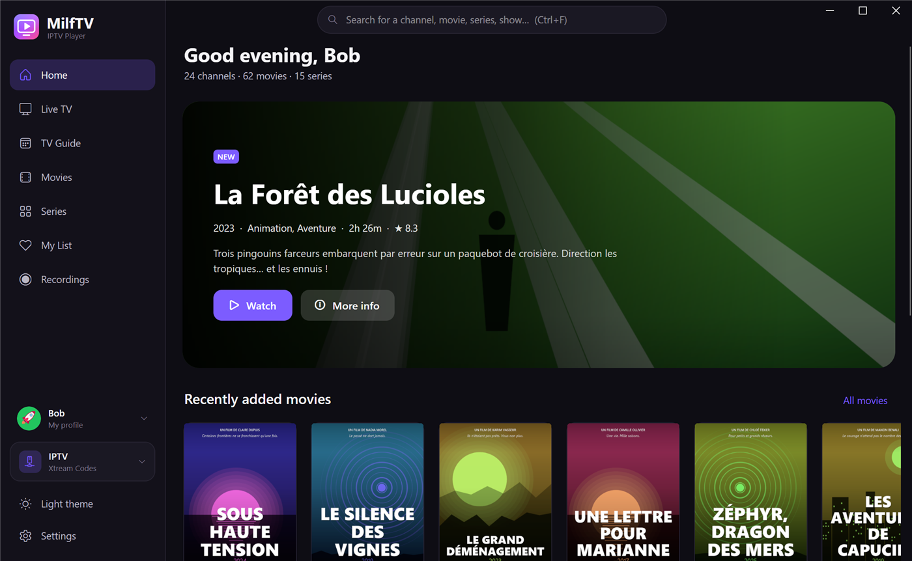
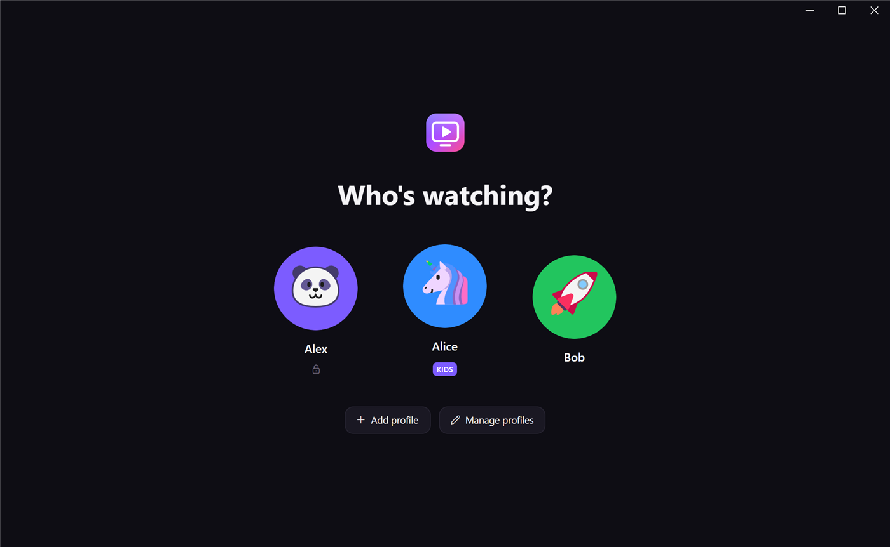
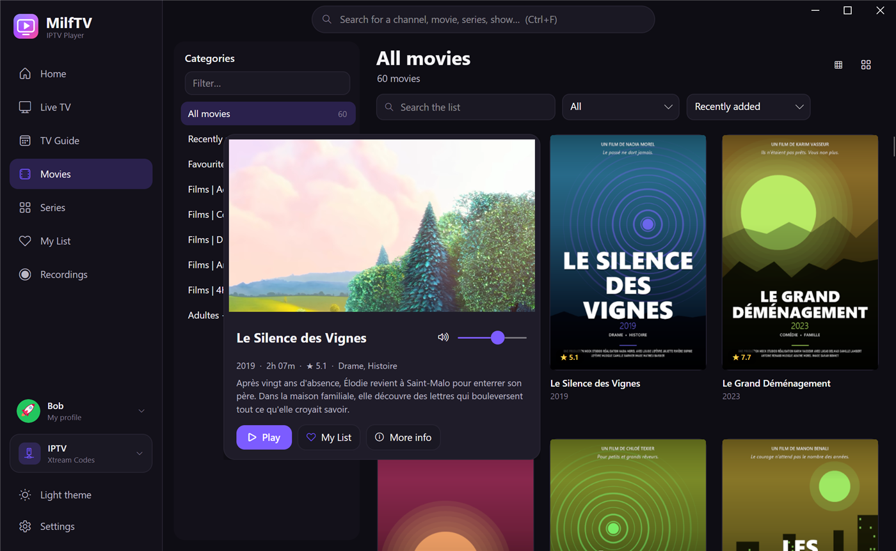
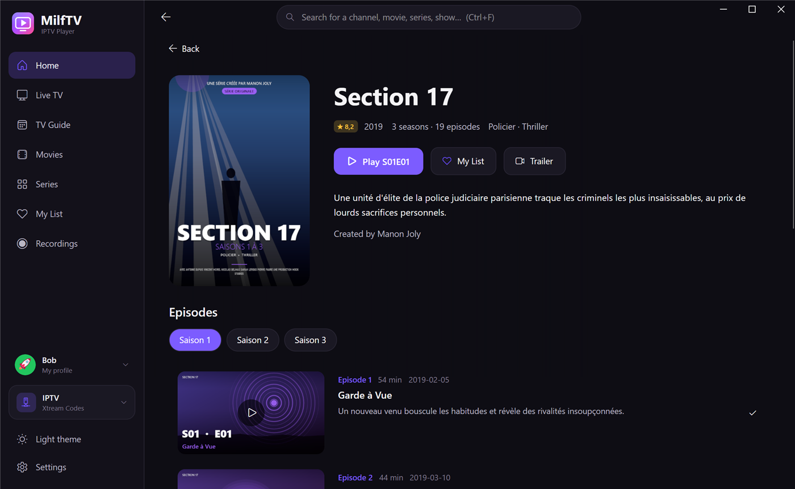
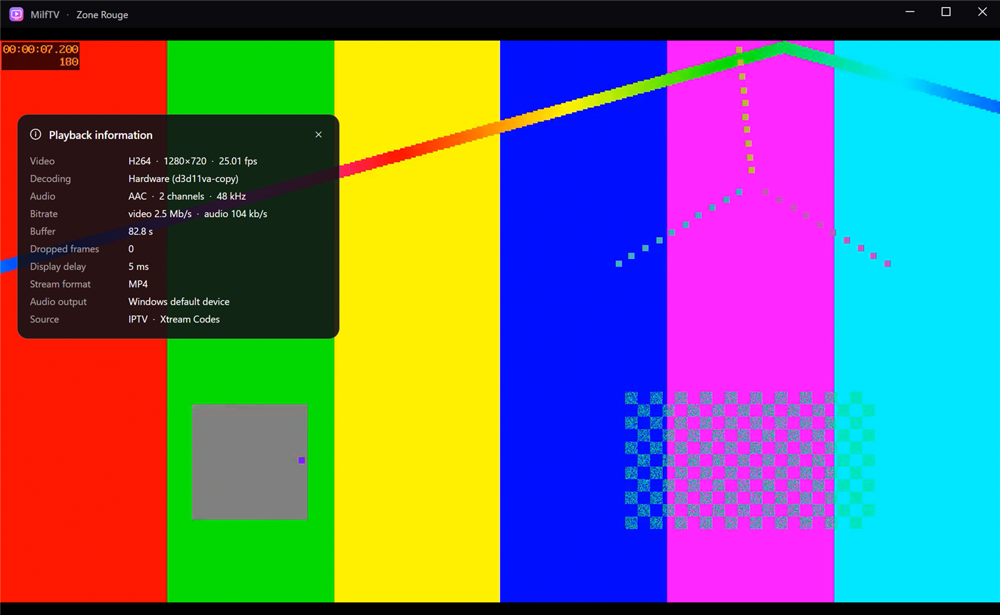
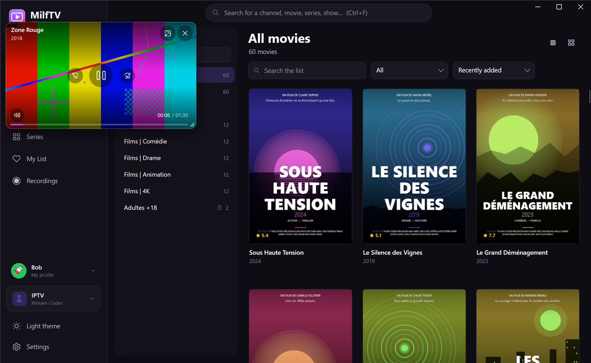
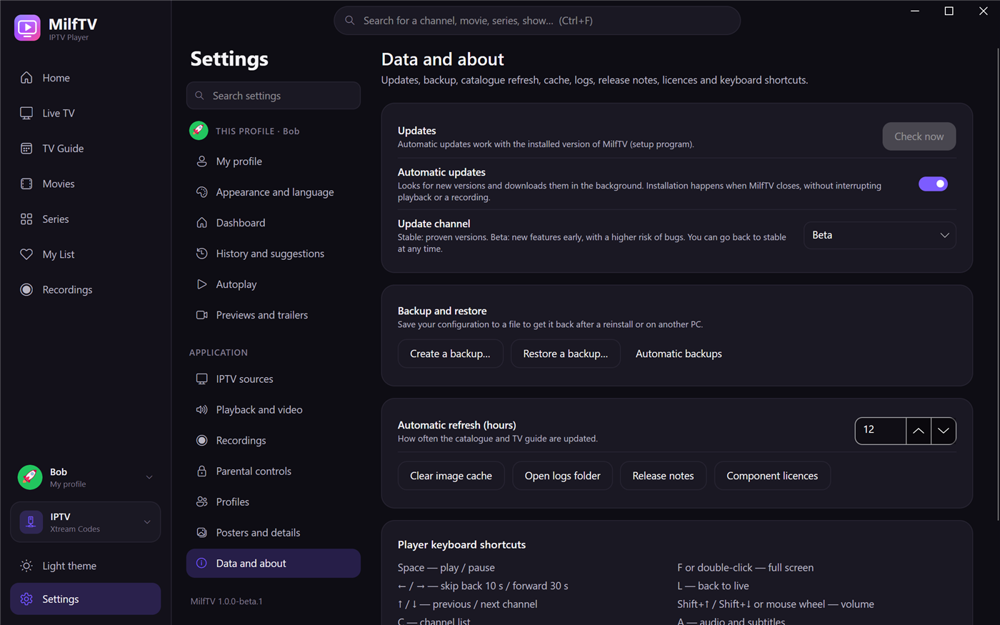

<p align="center"></p>

<h1 align="center">MilfTV</h1>

<p align="center">Ein moderner IPTV-Player für Windows: Live-TV mit Programmführer, Filme und Serien, Aufnahmen, Profile und Jugendschutz.</p>

<p align="center">
  <a href="https://github.com/MilFister/MilfTV/releases"></a>
  
  
  <a href="LICENSE"></a>
</p>

<p align="center"><a href="README.md">English</a> · <a href="README.fr.md">Français</a> · <a href="README.es.md">Español</a> · <b>Deutsch</b> · <a href="README.it.md">Italiano</a> · <a href="README.pt.md">Português</a></p>

> [!IMPORTANT]
> MilfTV ist in der **Beta-Phase**: Es funktioniert, kann aber noch Fehler enthalten. Bitte melden Sie sie im Reiter [Issues](https://github.com/MilFister/MilfTV/issues).
>
> MilfTV ist nur ein Player: Es stellt keine Sender, Filme oder Serien bereit. Nutzen Sie es mit Ihrem eigenen IPTV-Abonnement oder mit Playlists, die Sie ansehen dürfen.



## Inhalt

- [Funktionen](#funktionen)
- [Screenshots](#screenshots)
- [Download und Installation](#download-und-installation)
- [Erste Schritte](#erste-schritte)
- [Updates und Beta-Kanal](#updates-und-beta-kanal)
- [Ihre Daten und Ihre Privatsphäre](#ihre-daten-und-ihre-privatsphäre)
- [Tastenkürzel](#tastenkürzel)
- [Fehlerbehebung](#fehlerbehebung)
- [Aus dem Quellcode erstellen](#aus-dem-quellcode-erstellen)
- [Versionshinweise](#versionshinweise)
- [Lizenz](#lizenz)

## Funktionen

**IPTV-Quellen**
- Xtream-Codes-Konten, M3U/M3U8-Playlists (Link oder lokale Datei) und MAC/Stalker-Portale (Beta).
- Jedes Profil hat eigene Quellen, privat oder geteilt; ein Profil ohne Quelle erhält die kostenlose Playlist „TV gratuite France“ (iptv-org).

**Live-TV**
- Sender nach Kategorien mit der laufenden Sendung und ihrem Fortschritt, Lieblingssender und zuletzt gesehene Sender.
- Programmführer (XMLTV) als Raster, von Ihrer Quelle oder von einer Adresse Ihrer Wahl.
- Zeitversetztes Fernsehen: anhalten, zurückspulen und wieder zum Live-Bild.

**Filme und Serien**
- Poster-Raster mit Kategorien, Sortierung und dem Filter „gesehen / nicht gesehen“.
- Detailseiten mit Inhalt, Besetzung, Bewertung und Trailer, ergänzt durch [TMDB](https://www.themoviedb.org) (kostenloser Schlüssel).
- Vorschau beim Darüberfahren über ein Poster, mit Trailer und Lautstärkeregler.
- Fortsetzen, wo Sie aufgehört haben, automatische nächste Folge, Verlauf und Meine Liste für jedes Profil.

**Player**
- [mpv](https://mpv.io)-Engine: Hardware-Dekodierung, 4K- und HDR-Quellen, Modus für hohe Bildqualität.
- Flüssige Anzeige mit der Bildwiederholrate des Bildschirms, mit automatischem Ausweichmodus auf PCs, die sie nicht unterstützen.
- Tonspuren, Untertitel, Audioausgabe, Seitenverhältnis, Geschwindigkeit, Lautstärke bis 150 %.
- Rechtsklickmenü, Informationen zur Wiedergabe, Tastenkürzel.
- Mini-Player: Schauen Sie in einem schwebenden, größenveränderbaren Fenster weiter, während Sie navigieren.

**Aufnahmen**
- Sofortaufnahme und geplante Aufnahmen aus dem Programmführer, in TS, MKV oder MP4.
- Schutzmechanismen: Speicherplatz, Begrenzung gleichzeitiger Aufnahmen, PC bleibt wach, Bestätigung vor dem Schließen.

**Profile und Jugendschutz**
- Mehrere Profile mit Avatar, Farbe, optionalem Passwort und eigenen Einstellungen.
- Kinderprofile, Jugendschutz-PIN, gesperrte Kategorien, automatische Sperre von Erwachsenenkategorien.

**Außerdem**
- 6 Sprachen: Deutsch, Englisch, Französisch, Spanisch, Italienisch, Portugiesisch.
- Helles und dunkles Design mit wählbarer Farbe, anpassbare Startseite, globale Suche (Strg+F).
- Automatische Updates (Kanäle Stabil und Beta), Sicherung und Wiederherstellung der Konfiguration, Versionshinweise in der App.

## Screenshots

| | |
|---|---|
|  **Profile** |  **Filme und Vorschau** |
|  **Serienseite** |  **Player und Wiedergabeinformationen** |
|  **Mini-Player** |  **Einstellungen: Updates und Sicherung** |

<sub>Die Screenshots zeigen die englische Oberfläche und einen Katalog von einem Testserver mit erfundenen Titeln und Postern. Trailerbild: *Big Buck Bunny* © Blender Foundation, CC BY 3.0.</sub>

## Download und Installation

Laden Sie die neueste Version auf der Seite [Releases](https://github.com/MilFister/MilfTV/releases) herunter:

| Datei | Was es ist |
|---|---|
| `MilfTV.App-beta-Setup.exe` | **Installationsprogramm (empfohlen).** Installiert MilfTV für Ihr Windows-Konto, ohne Administratorrechte, mit einer Verknüpfung im Startmenü und automatischen Updates; eine Desktop-Verknüpfung wird beim ersten Start angeboten. |
| `MilfTV.App-beta-Portable.zip` | **Portable Version.** An beliebiger Stelle entpacken und `MilfTV.exe` starten; es wird nichts installiert. |
| `MilfTV.App-beta-arm64-Setup.exe` | **Installationsprogramm für Windows on ARM** (ARM64-PCs, z. B. Snapdragon). Wie oben, als native ARM64-Version. |
| `MilfTV.App-beta-arm64-Portable.zip` | **Portable Version für Windows on ARM.** |

**Voraussetzungen**
- Windows 10 oder 11, auf einem 64-Bit-PC (Intel / AMD) oder einem Windows-on-ARM-PC (ARM64).
- Eine Grafikkarte mit Direct3D 11 und aktuellem Treiber.
- Die WebView2-Laufzeit (in Windows 10/11 enthalten) für Trailer.

**Windows SmartScreen.** Das Installationsprogramm ist noch nicht signiert, daher zeigt Windows beim ersten Mal möglicherweise „Der Computer wurde durch Windows geschützt“. Klicken Sie auf **Weitere Informationen** und dann auf **Trotzdem ausführen**.

**Deinstallation** über Windows-Einstellungen › Apps. Ihre Profile, Einstellungen und Ihr Verlauf bleiben erhalten (siehe [Ihre Daten](#ihre-daten-und-ihre-privatsphäre)).

## Erste Schritte

1. **Erstellen Sie Ihr Profil** beim ersten Start (Name, Avatar, optionales Passwort).
2. **Fügen Sie eine Quelle hinzu** über die Seitenleiste: ein Xtream-Codes-Konto (Server, Benutzername, Passwort), eine M3U-Playlist (Link oder Datei) oder ein MAC-Portal. Ohne Quelle wird die kostenlose Playlist „TV gratuite France“ hinzugefügt.
3. **Optional: Fügen Sie einen TMDB-Schlüssel hinzu** unter Einstellungen › Poster und Details, um hochwertige Poster, Inhaltsangaben, Besetzung und Trailer zu erhalten. Der Schlüssel ist kostenlos auf [themoviedb.org](https://www.themoviedb.org/settings/api).
4. Entdecken Sie **Live-TV**, das **TV-Programm**, **Filme** und **Serien**. Ein Rechtsklick auf das Video öffnet Ton, Untertitel und mehr.

## Updates und Beta-Kanal

Die installierte Version sucht kurz nach dem Start und dann alle 12 Stunden auf GitHub nach Updates. Eine neue Version wird im Hintergrund heruntergeladen und **beim Schließen von MilfTV** installiert, sodass nie etwas unterbrochen wird. „Zum Installieren neu starten“ unter Einstellungen › Daten und Info erledigt das sofort.

- **Stabil** erhält getestete Versionen; **Beta** erhält Neuheiten früher, mit höherem Fehlerrisiko. Eine Beta-Installation bleibt standardmäßig auf Beta.
- Ändern Sie den Kanal unter Einstellungen › Daten und Info › Update-Kanal. Beim Wechsel zu Beta wird zuerst automatisch eine Sicherung Ihrer Konfiguration erstellt.
- Die Rückkehr zu Stabil bei installierter Beta installiert die neueste stabile Version neu, auch wenn sie älter ist; Ihre Profile und Einstellungen bleiben erhalten.

## Ihre Daten und Ihre Privatsphäre

MilfTV hat **kein Konto, keine Werbung und keine Telemetrie**. Es verbindet sich nur mit:
- Ihren IPTV-Quellen und den von Ihnen angegebenen Programmführer-Adressen;
- TMDB, wenn Sie einen Schlüssel eingegeben haben (Poster, Details, Trailersuche);
- YouTube (erweiterter Datenschutzmodus), um Trailer abzuspielen;
- GitHub, um nach Updates zu suchen;
- dem Projekt iptv-org, nur wenn die kostenlose Playlist verwendet wird.

| Daten | Speicherort |
|---|---|
| Profile, Quellen, Einstellungen | `%APPDATA%\MilfTV\settings.json` |
| Profilbilder | `%APPDATA%\MilfTV\avatars` |
| Verlauf, Meine Liste, Favoriten, Aufnahmeliste, Programmführer | `%LOCALAPPDATA%\MilfTV\milftv.db` |
| Bild- und Katalog-Cache, Puffer für zeitversetztes Fernsehen | `%LOCALAPPDATA%\MilfTV\cache` |
| Automatische Sicherungen | `%LOCALAPPDATA%\MilfTV\backups` |
| Protokolle | `%LOCALAPPDATA%\MilfTV\logs` |
| Installierte Anwendung | `%LOCALAPPDATA%\MilfTV.App` |
| Aufnahmen | `Videos\MilfTV` (einstellbar) |

Quellpasswörter und der TMDB-Schlüssel werden mit Ihrem Windows-Konto verschlüsselt (DPAPI); Profilpasswörter und die Jugendschutz-PIN werden nur als Hashwerte gespeichert.

Der Jugendschutz hält Kinder von Erwachseneninhalten und geschützten Einstellungen fern, doch wer Ihre Windows-Sitzung nutzt, kann die Einstellungsdatei trotzdem bearbeiten. Für eine echte Trennung geben Sie jedem Kind ein eigenes Windows-Konto.

**Sicherung und Wiederherstellung** (Einstellungen › Daten und Info) speichert Ihre Profile, Quellen, Einstellungen, Ihren Verlauf, Meine Liste, Favoriten und die Aufnahmeliste in einer `.milftv-backup`-Datei. Aufgenommene Videos, der Programmführer und Caches sind nicht enthalten. Vergeben Sie ein Passwort für die Sicherung, um Quellpasswörter auf einem anderen PC wiederherzustellen.

## Tastenkürzel

| Taste | Aktion |
|---|---|
| Leertaste | Wiedergabe / Pause |
| ← / → | 10 s zurück / 30 s vor |
| ↑ / ↓ | Vorheriger / nächster Sender |
| Umschalt+↑ / Umschalt+↓, Mausrad | Lautstärke |
| F, Doppelklick | Vollbild |
| L | Zurück zum Live-Bild |
| C | Senderliste |
| A | Ton und Untertitel |
| R | Aufnehmen |
| M | Stumm |
| I | Mini-Player |
| Esc | Vollbild verlassen, dann zum Mini-Player verkleinern |
| Strg+F | Suchen |

## Fehlerbehebung

- **Ton, aber kein Bild** (virtuelle Maschine, Remotedesktop, sehr alter Treiber): MilfTV benötigt Direct3D-11-Grafikbeschleunigung. Aktualisieren Sie Ihren Grafiktreiber.
- **Das Fenster erscheint nicht**: MilfTV wechselt beim nächsten Start von selbst in den kompatiblen Anzeigemodus. Sie können es auch mit `MilfTV.exe --safe-mode` starten.
- **„Das Sicherheitszertifikat des Servers ist ungültig“**: Ihr Anbieter verwendet ein ungültiges HTTPS-Zertifikat. Wenn Sie ihm vertrauen, aktivieren Sie „Ungültiges Zertifikat akzeptieren“ in den erweiterten Optionen der Quelle; in einem öffentlichen Netzwerk könnte die Verbindung zu diesem Server dann abgefangen werden.
- **Ein Sender spielt nicht ab**: Prüfen Sie ihn in einem anderen Player; MilfTV verbindet Live-Streams automatisch bis zu 5-mal in 2 Minuten neu.
- **Protokolle**: Einstellungen › Daten und Info › Protokollordner öffnen. Hängen Sie das neueste Protokoll nach einem kurzen Blick an Ihre Fehlermeldung an: Es kann die Adresse Ihres Servers enthalten.

## Aus dem Quellcode erstellen

Voraussetzungen: Windows, das [.NET 10 SDK](https://dotnet.microsoft.com/download) und die WebView2-Laufzeit.

1. Laden Sie einen **libmpv**-Build herunter (`mpv-dev-x86_64-*.7z` von [shinchiro/mpv-winbuild-cmake](https://github.com/shinchiro/mpv-winbuild-cmake/releases)) und kopieren Sie `libmpv-2.dll` nach `native/`. Mit rund 120 MB ist sie zu groß für das Repository. `native/vulkan-1.dll` (Vulkan-Loader von Khronos) ist bereits enthalten. Für die **ARM64**-Version (Windows-on-ARM-PCs) legen Sie die `libmpv-2.dll` aus `mpv-dev-aarch64-*.7z` nach `native/arm64/` (ihr ARM64-Vulkan-Loader ist bereits enthalten) und starten `release.ps1` mit `-Arch arm64`: Sie hat eigene Update-Kanäle.
2. Erstellen und starten:

```powershell
dotnet build src/MilfTV -c Debug
```

3. Release-Build mit Installationsprogramm (Velopack, wiederhergestellt über `dotnet tool restore`):

```powershell
.\build\release.ps1 -UpdateRepo https://github.com/MilFister/MilfTV -Version 1.0.0-beta.2 -Channel beta
```

`build\release.ps1` veröffentlicht eine einzelne ausführbare Datei, erstellt das Installationsprogramm, die portable Version und die Update-Pakete in `artifacts\releases`, fügt die Versionshinweise bei und kann auf GitHub veröffentlichen (`-Upload`, mit `$env:GITHUB_TOKEN`) oder die Dateien signieren (`-SignParams`, `-AzureSignFile`). `build\changelog.ps1` erzeugt die `CHANGELOG`-Dateien aus `src/MilfTV/Assets/changelog.json`, das auch die App anzeigt.

| Ordner | Inhalt |
|---|---|
| `src/MilfTV/Core` | Modelle, zentraler Zustand, Updates, Sicherung, Versionshinweise |
| `src/MilfTV/Providers` | Quellen Xtream, M3U und Stalker |
| `src/MilfTV/Epg` | XMLTV-Programmführer |
| `src/MilfTV/Player` | libmpv-Anbindung und Videofläche |
| `src/MilfTV/Recording` | Aufnahmen |
| `src/MilfTV/ViewModels`, `Views`, `Controls` | Oberfläche (Avalonia, MVVM) |
| `src/MilfTV/Assets/i18n` | Übersetzungen (6 Sprachen) |

Erstellt mit [Avalonia](https://avaloniaui.net), [mpv](https://mpv.io), [Velopack](https://velopack.io) und [CommunityToolkit.Mvvm](https://github.com/CommunityToolkit/dotnet).

## Versionshinweise

Siehe [CHANGELOG.de.md](CHANGELOG.de.md), auch in der App verfügbar (Einstellungen › Daten und Info › Versionshinweise).

## Lizenz

MilfTV ist freie Software unter der [GNU General Public License v3.0](LICENSE). Es enthält Komponenten von Drittanbietern (libmpv, den Vulkan-Loader, Avalonia, SkiaSharp…), die mit ihren Lizenzen in [THIRD-PARTY-NOTICES.md](THIRD-PARTY-NOTICES.md) aufgeführt sind.

Dieses Produkt verwendet die TMDB-API, wird aber von TMDB weder unterstützt noch zertifiziert.
