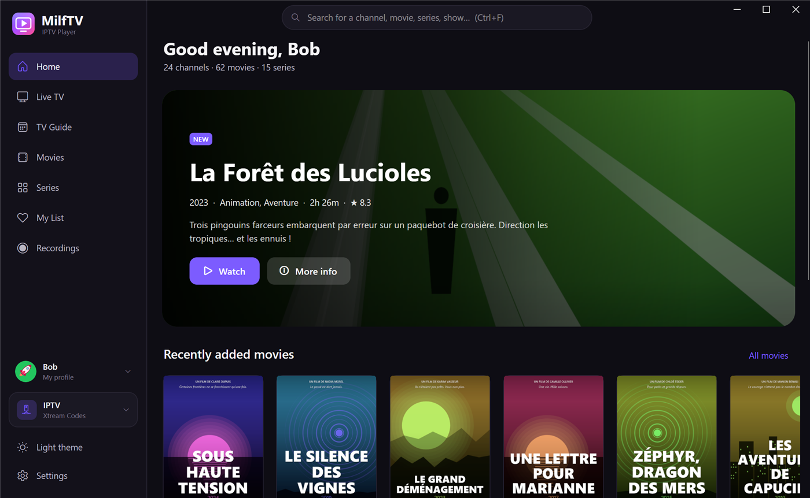
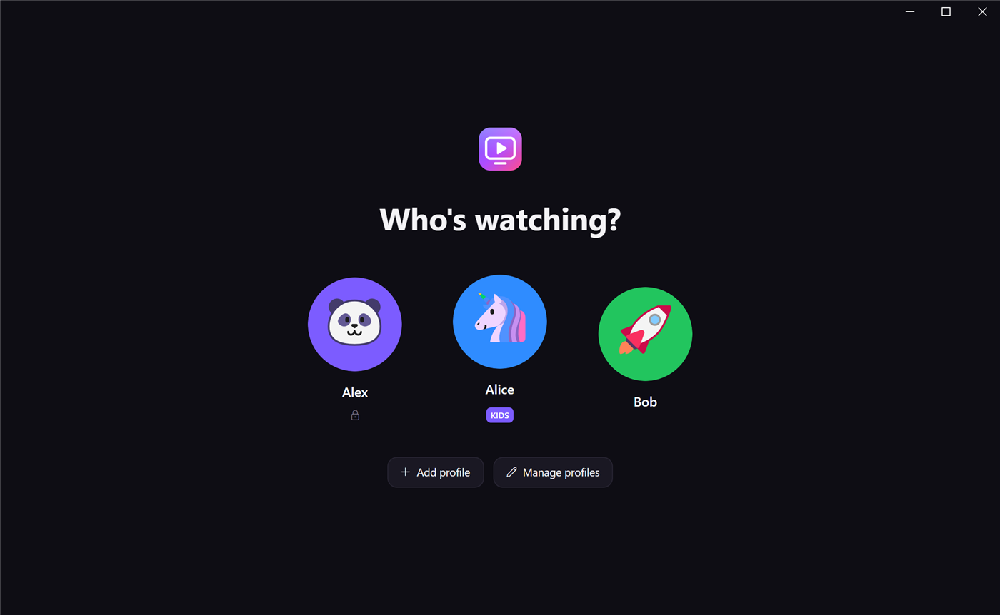
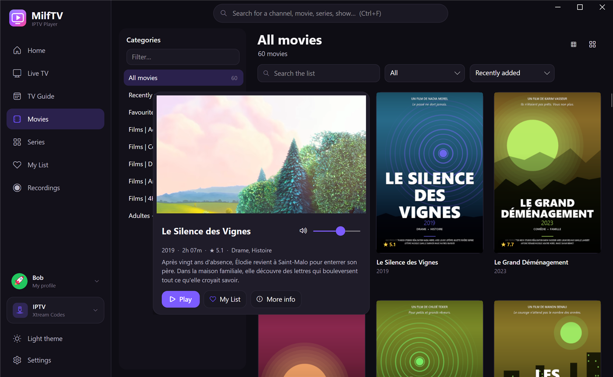
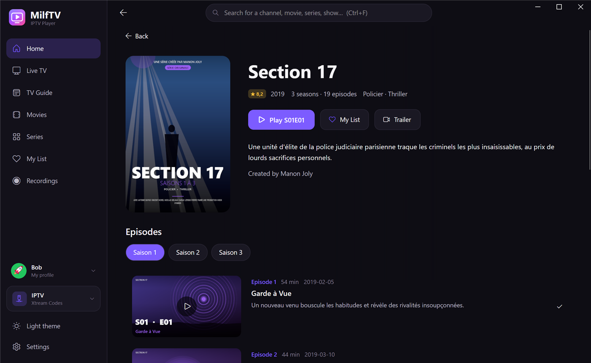
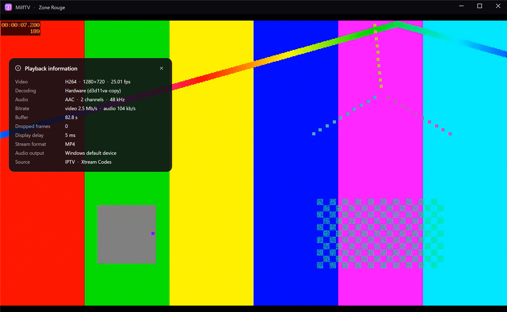
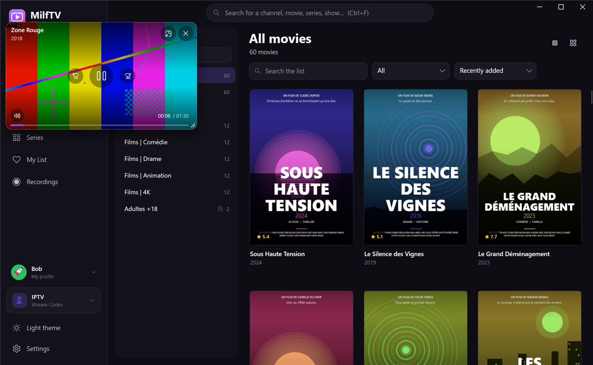
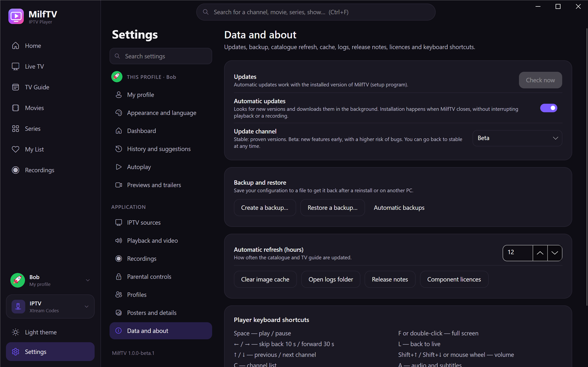

<p align="center"></p>

<h1 align="center">MilfTV</h1>

<p align="center">Un reproductor IPTV moderno para Windows: TV en directo con guía de programación, películas y series, grabaciones, perfiles y control parental.</p>

<p align="center">
  <a href="https://github.com/MilFister/MilfTV/releases"></a>
  
  
  <a href="LICENSE"></a>
</p>

<p align="center"><a href="README.md">English</a> · <a href="README.fr.md">Français</a> · <b>Español</b> · <a href="README.de.md">Deutsch</a> · <a href="README.it.md">Italiano</a> · <a href="README.pt.md">Português</a></p>

> [!IMPORTANT]
> MilfTV está en **beta**: funciona, pero aún puedes encontrar errores. Notifícalos en la pestaña [Issues](https://github.com/MilFister/MilfTV/issues).
>
> MilfTV es solo un reproductor: no ofrece ningún canal, película ni serie. Úsalo con tu propia suscripción IPTV o con listas que tengas derecho a ver.



## Índice

- [Funciones](#funciones)
- [Capturas de pantalla](#capturas-de-pantalla)
- [Descarga e instalación](#descarga-e-instalación)
- [Primeros pasos](#primeros-pasos)
- [Actualizaciones y canal beta](#actualizaciones-y-canal-beta)
- [Tus datos y tu privacidad](#tus-datos-y-tu-privacidad)
- [Atajos de teclado](#atajos-de-teclado)
- [Solución de problemas](#solución-de-problemas)
- [Compilar desde el código fuente](#compilar-desde-el-código-fuente)
- [Notas de la versión](#notas-de-la-versión)
- [Licencia](#licencia)

## Funciones

**Fuentes IPTV**
- Cuentas Xtream Codes, listas M3U/M3U8 (enlace o archivo local) y portales MAC/Stalker (beta).
- Cada perfil tiene sus propias fuentes, privadas o compartidas; un perfil sin fuente recibe la lista gratuita «TV gratuite France» (iptv-org).

**TV en directo**
- Canales por categoría con el programa en curso y su progreso, canales favoritos y vistos recientemente.
- Guía de TV (XMLTV) en cuadrícula, de tu fuente o de una dirección que elijas.
- Directo en diferido: pausa, retrocede y vuelve al directo.

**Películas y series**
- Cuadrículas de carátulas con categorías, orden y filtro «vistas / sin ver».
- Fichas con sinopsis, reparto, nota y tráiler, enriquecidas con [TMDB](https://www.themoviedb.org) (clave gratuita).
- Vista previa al pasar el puntero por una carátula, con su tráiler y un control de volumen.
- Reanuda donde lo dejaste, reproducción automática del siguiente episodio, historial y Mi lista para cada perfil.

**Reproductor**
- Motor [mpv](https://mpv.io): decodificación por hardware, fuentes 4K y HDR, modo de imagen de alta calidad.
- Visualización fluida a la frecuencia de la pantalla, con alternativa automática en los PC que no la admiten.
- Pistas de audio, subtítulos, salida de audio, formato de imagen, velocidad, volumen hasta el 150 %.
- Menú del clic derecho, panel de información de reproducción, atajos de teclado.
- Minirreproductor: sigue viendo en una ventana flotante y redimensionable mientras navegas.

**Grabaciones**
- Grabación inmediata y grabaciones programadas desde la guía de TV, en TS, MKV o MP4.
- Salvaguardas: espacio en disco, límite de grabaciones simultáneas, PC despierto, confirmación antes de cerrar.

**Perfiles y control parental**
- Varios perfiles con avatar, color, contraseña opcional y preferencias propias.
- Perfiles infantiles, código parental, categorías bloqueadas, bloqueo automático de las categorías para adultos.

**Y además**
- 6 idiomas: español, inglés, francés, alemán, italiano, portugués.
- Temas claro y oscuro con color a elegir, inicio personalizable, búsqueda global (Ctrl+F).
- Actualizaciones automáticas (canales Estable y Beta), copia de seguridad y restauración de la configuración, notas de la versión en la aplicación.

## Capturas de pantalla

| | |
|---|---|
|  **Perfiles** |  **Películas y vista previa** |
|  **Ficha de una serie** |  **Reproductor e información de reproducción** |
|  **Minirreproductor** |  **Ajustes: actualizaciones y copia de seguridad** |

<sub>Las capturas muestran la interfaz en inglés y un catálogo de un servidor de prueba con títulos y carátulas inventados. Imagen del tráiler: *Big Buck Bunny* © Blender Foundation, CC BY 3.0.</sub>

## Descarga e instalación

Descarga la última versión en la página [Releases](https://github.com/MilFister/MilfTV/releases):

| Archivo | Qué es |
|---|---|
| `MilfTV.App-beta-Setup.exe` | **Instalador (recomendado).** Instala MilfTV para tu cuenta de Windows, sin derechos de administrador, con accesos directos en el escritorio y el menú Inicio, y actualizaciones automáticas. |
| `MilfTV.App-beta-Portable.zip` | **Versión portátil.** Descomprímela donde quieras y ejecuta `MilfTV.exe`; no se instala nada. |

**Requisitos**
- Windows 10 u 11 de 64 bits.
- Una tarjeta gráfica compatible con Direct3D 11 y con el controlador actualizado.
- El runtime WebView2 (incluido en Windows 10/11) para los tráileres.

**Windows SmartScreen.** El instalador aún no está firmado, así que Windows puede mostrar «Windows protegió su PC» la primera vez. Haz clic en **Más información** y luego en **Ejecutar de todas formas**.

**Desinstalar** desde Configuración de Windows › Aplicaciones. Tus perfiles, ajustes e historial se conservan (consulta [Tus datos](#tus-datos-y-tu-privacidad)).

## Primeros pasos

1. **Crea tu perfil** en el primer inicio (nombre, avatar, contraseña opcional).
2. **Añade una fuente** desde la barra lateral: una cuenta Xtream Codes (servidor, usuario, contraseña), una lista M3U (enlace o archivo) o un portal MAC. Sin fuente, se añade la lista gratuita «TV gratuite France».
3. **Opcional: añade una clave de TMDB** en Ajustes › Carátulas y fichas para obtener carátulas de calidad, sinopsis, reparto y tráileres. La clave es gratuita en [themoviedb.org](https://www.themoviedb.org/settings/api).
4. Explora **TV en directo**, la **Guía de TV**, **Películas** y **Series**. Haz clic derecho en el vídeo para el audio, los subtítulos y mucho más.

## Actualizaciones y canal beta

La versión instalada busca actualizaciones en GitHub poco después de iniciarse y luego cada 12 horas. Una nueva versión se descarga en segundo plano y se instala **al cerrar MilfTV**, así que nunca se interrumpe nada. «Reiniciar para instalar», en Ajustes › Datos y acerca de, lo hace al momento.

- **Estable** recibe las versiones probadas; **Beta** recibe las novedades antes, con más riesgo de errores. Una instalación beta se queda en Beta por defecto.
- Cambia de canal en Ajustes › Datos y acerca de › Canal de actualizaciones. Al pasar a Beta se crea antes una copia automática de tu configuración.
- Volver a Estable con una beta instalada reinstala la última versión estable, aunque sea más antigua; tus perfiles y ajustes se conservan.

## Tus datos y tu privacidad

MilfTV **no tiene cuenta, ni publicidad, ni telemetría**. Solo se conecta:
- a tus fuentes IPTV y a las direcciones de guía de TV que indiques;
- a TMDB, si has introducido una clave (carátulas, fichas, búsqueda de tráileres);
- a YouTube (modo de privacidad mejorada) para reproducir los tráileres;
- a GitHub, para buscar actualizaciones;
- al proyecto iptv-org, solo si se usa la lista gratuita.

| Datos | Ubicación |
|---|---|
| Perfiles, fuentes, ajustes | `%APPDATA%\MilfTV\settings.json` |
| Imágenes de los perfiles | `%APPDATA%\MilfTV\avatars` |
| Historial, Mi lista, favoritos, lista de grabaciones, guía de TV | `%LOCALAPPDATA%\MilfTV\milftv.db` |
| Caché de imágenes y catálogos, memoria del directo en diferido | `%LOCALAPPDATA%\MilfTV\cache` |
| Copias automáticas | `%LOCALAPPDATA%\MilfTV\backups` |
| Registros | `%LOCALAPPDATA%\MilfTV\logs` |
| Aplicación instalada | `%LOCALAPPDATA%\MilfTV.App` |
| Grabaciones | `Vídeos\MilfTV` (configurable) |

Las contraseñas de las fuentes y la clave de TMDB se cifran con tu cuenta de Windows (DPAPI); las contraseñas de los perfiles y el código parental solo se guardan como huellas.

**Copia de seguridad y restauración** (Ajustes › Datos y acerca de) guarda tus perfiles, fuentes, ajustes, historial, Mi lista, favoritos y lista de grabaciones en un archivo `.milftv-backup`. Los vídeos grabados, la guía de TV y las cachés no se incluyen. Añade una contraseña a la copia para restaurar las contraseñas de las fuentes en otro PC.

## Atajos de teclado

| Tecla | Acción |
|---|---|
| Espacio | Reproducir / pausa |
| ← / → | Retroceder 10 s / avanzar 30 s |
| ↑ / ↓ | Canal anterior / siguiente |
| Mayús+↑ / Mayús+↓, rueda del ratón | Volumen |
| F, doble clic | Pantalla completa |
| L | Volver al directo |
| C | Lista de canales |
| A | Audio y subtítulos |
| R | Grabar |
| M | Silenciar |
| I | Minirreproductor |
| Esc | Salir de pantalla completa y luego reducir al minirreproductor |
| Ctrl+F | Buscar |

## Solución de problemas

- **Hay sonido pero no imagen** (máquina virtual, escritorio remoto, controlador muy antiguo): MilfTV necesita la aceleración gráfica Direct3D 11. Actualiza el controlador de tu tarjeta gráfica.
- **La ventana no aparece**: MilfTV pasa por sí solo al modo de visualización compatible en el siguiente inicio. También puedes iniciarlo con `MilfTV.exe --safe-mode`.
- **Un canal no se reproduce**: compruébalo en otro reproductor; MilfTV reconecta los directos automáticamente hasta 5 veces en 2 minutos.
- **Registros**: Ajustes › Datos y acerca de › Abrir la carpeta de registros. Adjunta el último registro a tu informe tras echarle un vistazo: puede mencionar la dirección de tu servidor.

## Compilar desde el código fuente

Requisitos: Windows, el [SDK de .NET 10](https://dotnet.microsoft.com/download) y el runtime WebView2.

1. Descarga una versión de **libmpv** (`mpv-dev-x86_64-*.7z` en [shinchiro/mpv-winbuild-cmake](https://github.com/shinchiro/mpv-winbuild-cmake/releases)) y copia `libmpv-2.dll` en `native/`. Con unos 120 MB, es demasiado grande para el repositorio. `native/vulkan-1.dll` (cargador Vulkan de Khronos) ya está incluido.
2. Compila y ejecuta:

```powershell
dotnet build src/MilfTV -c Debug
```

3. Versión de publicación con el instalador (Velopack, restaurado mediante `dotnet tool restore`):

```powershell
.\build\release.ps1 -UpdateRepo https://github.com/MilFister/MilfTV -Version 1.0.0-beta.1 -Channel beta
```

`build\release.ps1` publica un ejecutable único, crea el instalador, la versión portátil y los paquetes de actualización en `artifacts\releases`, adjunta las notas de la versión y puede publicar en GitHub (`-Upload`, con `$env:GITHUB_TOKEN`) o firmar los archivos (`-SignParams`, `-AzureSignFile`). `build\changelog.ps1` regenera los archivos `CHANGELOG` a partir de `src/MilfTV/Assets/changelog.json`, que la aplicación también muestra.

| Carpeta | Contenido |
|---|---|
| `src/MilfTV/Core` | Modelos, estado central, actualizaciones, copias de seguridad, notas de la versión |
| `src/MilfTV/Providers` | Fuentes Xtream, M3U y Stalker |
| `src/MilfTV/Epg` | Guía de TV XMLTV |
| `src/MilfTV/Player` | Enlace con libmpv y superficie de vídeo |
| `src/MilfTV/Recording` | Grabaciones |
| `src/MilfTV/ViewModels`, `Views`, `Controls` | Interfaz (Avalonia, MVVM) |
| `src/MilfTV/Assets/i18n` | Traducciones (6 idiomas) |

Creado con [Avalonia](https://avaloniaui.net), [mpv](https://mpv.io), [Velopack](https://velopack.io) y [CommunityToolkit.Mvvm](https://github.com/CommunityToolkit/dotnet).

## Notas de la versión

Consulta [CHANGELOG.es.md](CHANGELOG.es.md), también disponibles en la aplicación (Ajustes › Datos y acerca de › Notas de la versión).

## Licencia

MilfTV es software libre bajo la [GNU General Public License v3.0](LICENSE). Incluye componentes de terceros (libmpv, el cargador Vulkan, Avalonia, SkiaSharp…), enumerados con sus licencias en [THIRD-PARTY-NOTICES.md](THIRD-PARTY-NOTICES.md).

Este producto usa la API de TMDB, pero TMDB no lo respalda ni lo certifica.
