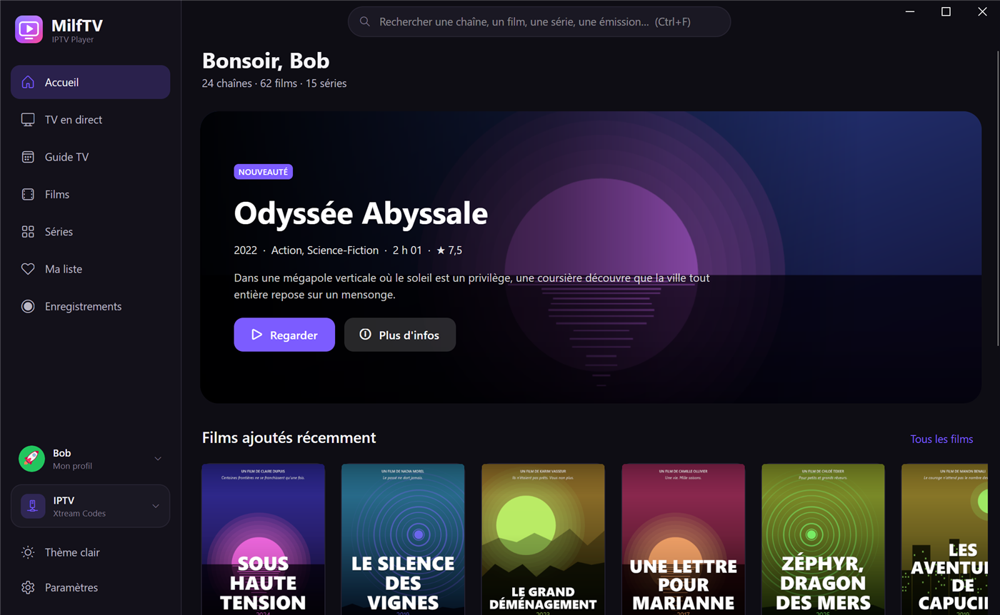
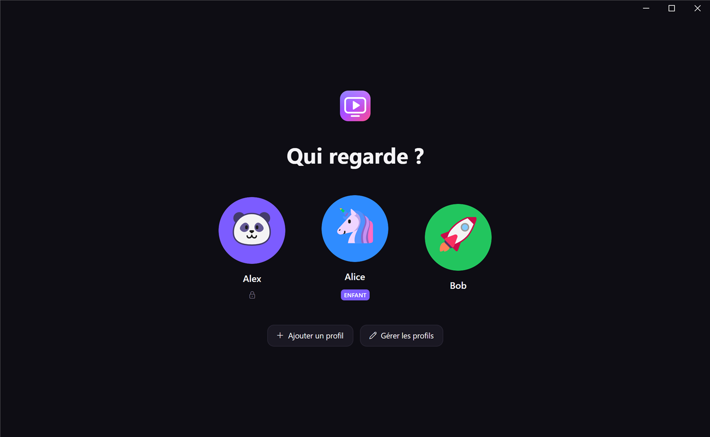
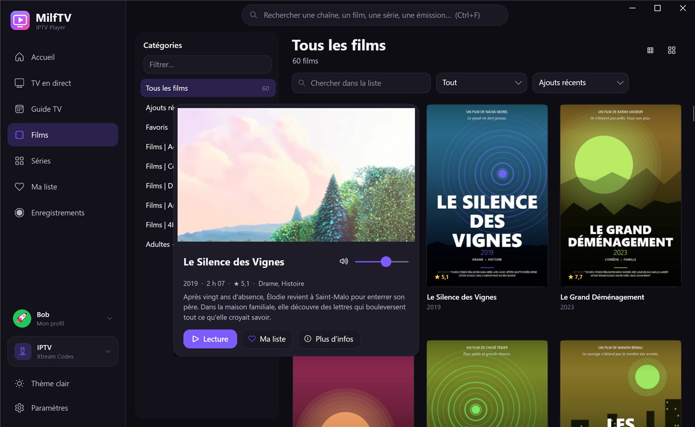
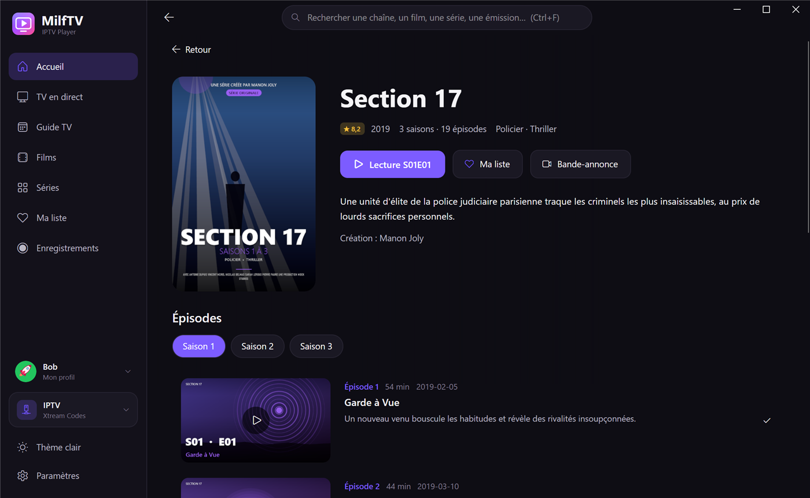
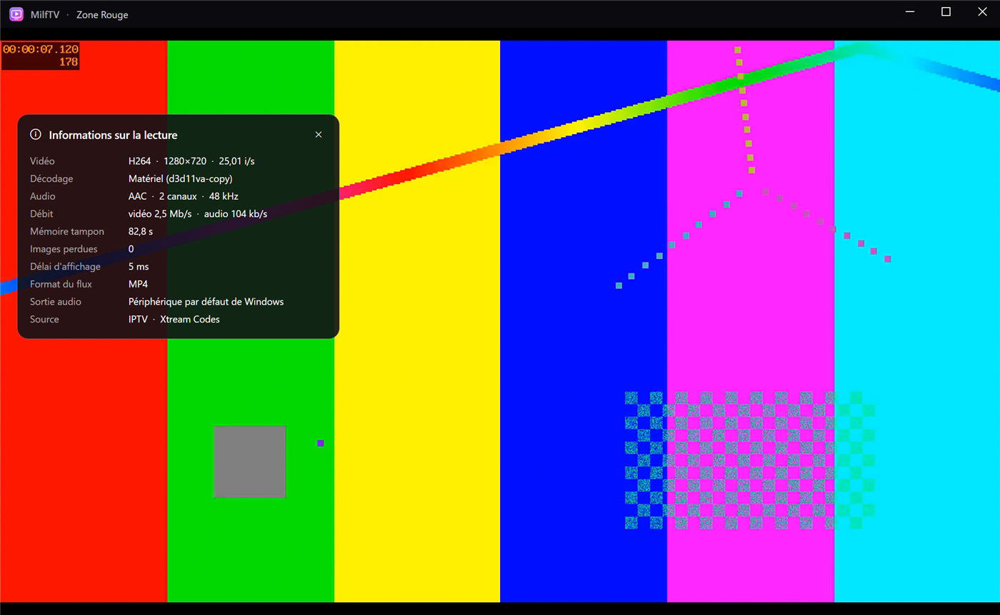
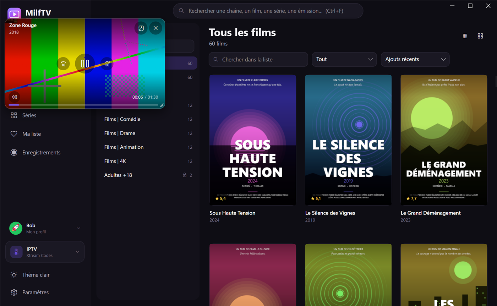
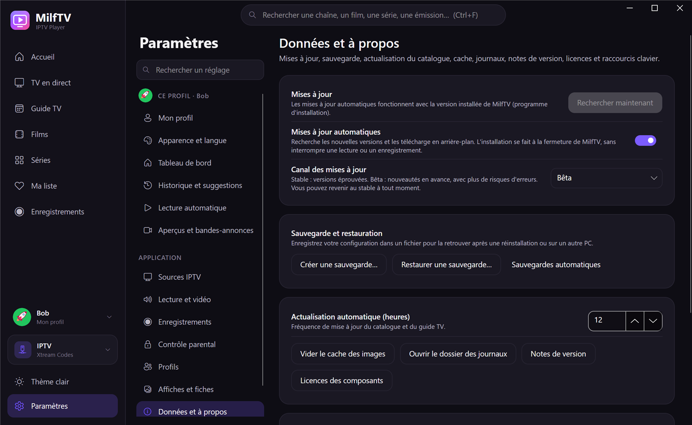

<p align="center"></p>

<h1 align="center">MilfTV</h1>

<p align="center">Un lecteur IPTV moderne pour Windows : TV en direct avec guide des programmes, films et séries, enregistrements, profils et contrôle parental.</p>

<p align="center">
  <a href="https://github.com/MilFister/MilfTV/releases"></a>
  
  
  <a href="LICENSE"></a>
</p>

<p align="center"><a href="README.md">English</a> · <b>Français</b> · <a href="README.es.md">Español</a> · <a href="README.de.md">Deutsch</a> · <a href="README.it.md">Italiano</a> · <a href="README.pt.md">Português</a></p>

> [!IMPORTANT]
> MilfTV est en **bêta** : il fonctionne, mais vous pouvez encore rencontrer des erreurs. Signalez-les dans l'onglet [Issues](https://github.com/MilFister/MilfTV/issues).
>
> MilfTV est uniquement un lecteur : il ne fournit aucune chaîne, aucun film ni aucune série. Utilisez-le avec votre propre abonnement IPTV ou des playlists que vous avez le droit de regarder.



## Sommaire

- [Fonctionnalités](#fonctionnalités)
- [Captures d'écran](#captures-décran)
- [Téléchargement et installation](#téléchargement-et-installation)
- [Premiers pas](#premiers-pas)
- [Mises à jour et canal bêta](#mises-à-jour-et-canal-bêta)
- [Vos données et votre vie privée](#vos-données-et-votre-vie-privée)
- [Raccourcis clavier](#raccourcis-clavier)
- [En cas de problème](#en-cas-de-problème)
- [Compiler depuis les sources](#compiler-depuis-les-sources)
- [Notes de version](#notes-de-version)
- [Licence](#licence)

## Fonctionnalités

**Sources IPTV**
- Comptes Xtream Codes, playlists M3U/M3U8 (lien ou fichier local) et portails MAC/Stalker (bêta).
- Chaque profil a ses propres sources, privées ou partagées ; un profil sans source reçoit la playlist gratuite « TV gratuite France » (iptv-org).

**TV en direct**
- Chaînes par catégorie avec le programme en cours et sa progression, chaînes favorites et regardées récemment.
- Guide TV (XMLTV) en grille, fourni par votre source ou depuis une adresse de votre choix.
- Direct différé : pause, retour en arrière et retour au direct.

**Films et séries**
- Grilles d'affiches avec catégories, tri et filtre « vus / pas encore vus ».
- Fiches avec résumé, distribution, note et bande-annonce, enrichies par [TMDB](https://www.themoviedb.org) (clé gratuite).
- Aperçu au survol des affiches, avec la bande-annonce et un réglage du volume.
- Reprise là où vous vous étiez arrêté, épisode suivant automatique, historique et Ma liste propres à chaque profil.

**Lecteur**
- Moteur [mpv](https://mpv.io) : décodage matériel, sources 4K et HDR, mode image haute qualité.
- Affichage fluide à la fréquence de l'écran, avec repli automatique sur les PC qui ne le permettent pas.
- Pistes audio, sous-titres, sortie audio, format d'image, vitesse, volume jusqu'à 150 %.
- Menu du clic droit, panneau d'informations de lecture, raccourcis clavier.
- Mini-lecteur : continuez à regarder dans une fenêtre flottante et redimensionnable pendant que vous naviguez.

**Enregistrements**
- Enregistrement immédiat et enregistrements programmés depuis le guide TV, en TS, MKV ou MP4.
- Garde-fous : espace disque, limite d'enregistrements simultanés, PC maintenu éveillé, confirmation avant de fermer.

**Profils et contrôle parental**
- Plusieurs profils avec avatar, couleur, mot de passe facultatif et préférences propres.
- Profils enfants, code parental, catégories verrouillées, verrouillage automatique des catégories adultes.

**Et aussi**
- 6 langues : français, anglais, espagnol, allemand, italien, portugais.
- Thèmes clair et sombre avec couleur au choix, accueil personnalisable, recherche globale (Ctrl+F).
- Mises à jour automatiques (canaux Stable et Bêta), sauvegarde et restauration de la configuration, notes de version dans l'application.

## Captures d'écran

| | |
|---|---|
|  **Profils** |  **Films et aperçu au survol** |
|  **Fiche d'une série** |  **Lecteur et informations de lecture** |
|  **Mini-lecteur** |  **Paramètres : mises à jour et sauvegarde** |

<sub>Le catalogue des captures provient d'un serveur de test, avec des titres et des affiches inventés. Image de bande-annonce : *Big Buck Bunny* © Blender Foundation, CC BY 3.0.</sub>

## Téléchargement et installation

Téléchargez la dernière version depuis la page [Releases](https://github.com/MilFister/MilfTV/releases) :

| Fichier | Ce que c'est |
|---|---|
| `MilfTV.App-beta-Setup.exe` | **Programme d'installation (recommandé).** Installe MilfTV pour votre compte Windows, sans droits administrateur, avec un raccourci dans le menu Démarrer et les mises à jour automatiques ; un raccourci sur le bureau est proposé au premier lancement. |
| `MilfTV.App-beta-Portable.zip` | **Version portable.** Décompressez-la où vous voulez et lancez `MilfTV.exe` ; rien n'est installé. |
| `MilfTV.App-beta-arm64-Setup.exe` | **Programme d'installation pour Windows sur ARM** (PC ARM64, par ex. Snapdragon). Comme ci-dessus, en version ARM64 native. |
| `MilfTV.App-beta-arm64-Portable.zip` | **Version portable pour Windows sur ARM.** |

**Configuration requise**
- Windows 10 ou 11, sur un PC 64 bits (Intel / AMD) ou un PC Windows sur ARM (ARM64).
- Une carte graphique compatible Direct3D 11 avec un pilote à jour.
- Le runtime WebView2 (inclus dans Windows 10/11) pour les bandes-annonces.

**Windows SmartScreen.** Le programme d'installation n'est pas encore signé : Windows peut afficher « Windows a protégé votre ordinateur » la première fois. Cliquez sur **Informations complémentaires**, puis sur **Exécuter quand même**.

**Désinstallation** depuis Paramètres Windows › Applications. Vos profils, réglages et historique sont conservés (voir [Vos données](#vos-données-et-votre-vie-privée)).

## Premiers pas

1. **Créez votre profil** au premier lancement (nom, avatar, mot de passe facultatif).
2. **Ajoutez une source** depuis la barre latérale : un compte Xtream Codes (serveur, identifiant, mot de passe), une playlist M3U (lien ou fichier) ou un portail MAC. Sans source, la playlist gratuite « TV gratuite France » est ajoutée pour vous.
3. **Facultatif : ajoutez une clé TMDB** dans Paramètres › Affiches et fiches pour obtenir des affiches de qualité, des résumés, la distribution et les bandes-annonces. La clé est gratuite sur [themoviedb.org](https://www.themoviedb.org/settings/api).
4. Explorez la **TV en direct**, le **guide TV**, les **films** et les **séries**. Faites un clic droit sur la vidéo pour l'audio, les sous-titres et plus encore.

## Mises à jour et canal bêta

La version installée cherche les mises à jour sur GitHub peu après son démarrage, puis toutes les 12 heures. Une nouvelle version est téléchargée en arrière-plan et installée **à la fermeture de MilfTV** : rien n'est jamais interrompu. « Redémarrer pour installer », dans Paramètres › Données et à propos, le fait tout de suite.

- **Stable** reçoit les versions éprouvées ; **Bêta** reçoit les nouveautés plus tôt, avec plus de risques d'erreurs. Une installation bêta reste en Bêta par défaut.
- Changez de canal dans Paramètres › Données et à propos › Canal des mises à jour. Le passage en Bêta crée d'abord une sauvegarde automatique de votre configuration.
- Revenir au Stable alors qu'une bêta est installée réinstalle la dernière version stable, même si elle est plus ancienne ; vos profils et réglages sont conservés.

## Vos données et votre vie privée

MilfTV n'a **ni compte, ni publicité, ni télémétrie**. Il se connecte uniquement :
- à vos sources IPTV et aux adresses de guide TV que vous indiquez ;
- à TMDB, si vous avez saisi une clé (affiches, fiches, recherche des bandes-annonces) ;
- à YouTube (mode de confidentialité renforcée) pour lire les bandes-annonces ;
- à GitHub, pour chercher les mises à jour ;
- au projet iptv-org, seulement si la playlist gratuite est utilisée.

| Données | Emplacement |
|---|---|
| Profils, sources, réglages | `%APPDATA%\MilfTV\settings.json` |
| Images des profils | `%APPDATA%\MilfTV\avatars` |
| Historique, Ma liste, favoris, liste des enregistrements, guide TV | `%LOCALAPPDATA%\MilfTV\milftv.db` |
| Cache des images et des catalogues, mémoire du direct différé | `%LOCALAPPDATA%\MilfTV\cache` |
| Sauvegardes automatiques | `%LOCALAPPDATA%\MilfTV\backups` |
| Journaux | `%LOCALAPPDATA%\MilfTV\logs` |
| Application installée | `%LOCALAPPDATA%\MilfTV.App` |
| Enregistrements | `Vidéos\MilfTV` (modifiable) |

Les mots de passe des sources et la clé TMDB sont chiffrés avec votre compte Windows (DPAPI) ; les mots de passe des profils et le code parental ne sont conservés que sous forme d'empreintes.

Le contrôle parental tient les enfants à l'écart des contenus adultes et des réglages protégés, mais une personne qui utilise votre session Windows peut toujours modifier le fichier des réglages. Pour une vraie séparation, donnez à chaque enfant son propre compte Windows.

**Sauvegarde et restauration** (Paramètres › Données et à propos) enregistre vos profils, sources, réglages, historique, Ma liste, favoris et liste des enregistrements dans un fichier `.milftv-backup`. Les vidéos enregistrées, le guide TV et les caches n'en font pas partie. Ajoutez un mot de passe de sauvegarde pour restaurer les mots de passe des sources sur un autre PC.

## Raccourcis clavier

| Touche | Action |
|---|---|
| Espace | Lecture / pause |
| ← / → | Reculer de 10 s / avancer de 30 s |
| ↑ / ↓ | Chaîne précédente / suivante |
| Maj+↑ / Maj+↓, molette | Volume |
| F, double-clic | Plein écran |
| L | Retour au direct |
| C | Liste des chaînes |
| A | Audio et sous-titres |
| R | Enregistrer |
| M | Couper le son |
| I | Mini-lecteur |
| Échap | Quitter le plein écran, puis réduire en mini-lecteur |
| Ctrl+F | Rechercher |

## En cas de problème

- **Du son mais pas d'image** (machine virtuelle, bureau à distance, pilote très ancien) : MilfTV a besoin de l'accélération graphique Direct3D 11. Mettez à jour le pilote de votre carte graphique.
- **La fenêtre ne s'affiche pas** : MilfTV repasse de lui-même en mode d'affichage compatible au démarrage suivant. Vous pouvez aussi le lancer avec `MilfTV.exe --safe-mode`.
- **« Le certificat de sécurité du serveur n'est pas valide »** : votre fournisseur utilise un certificat HTTPS non valide. Si vous lui faites confiance, cochez « Accepter un certificat non valide » dans les options avancées de la source ; sur un réseau public, la connexion à ce serveur pourrait alors être interceptée.
- **Une chaîne ne se lance pas** : vérifiez-la dans un autre lecteur ; MilfTV relance automatiquement les directs jusqu'à 5 fois en 2 minutes.
- **Journaux** : Paramètres › Données et à propos › Ouvrir le dossier des journaux. Joignez le dernier journal à votre signalement après l'avoir parcouru : il peut mentionner l'adresse de votre serveur.

## Compiler depuis les sources

Prérequis : Windows, le [SDK .NET 10](https://dotnet.microsoft.com/download) et le runtime WebView2.

1. Téléchargez une version de **libmpv** (`mpv-dev-x86_64-*.7z` sur [shinchiro/mpv-winbuild-cmake](https://github.com/shinchiro/mpv-winbuild-cmake/releases)) et copiez `libmpv-2.dll` dans `native/`. Avec environ 120 Mo, elle est trop volumineuse pour le dépôt. `native/vulkan-1.dll` (chargeur Vulkan de Khronos) y est déjà. Pour la version **ARM64** (PC Windows sur ARM), placez la `libmpv-2.dll` de `mpv-dev-aarch64-*.7z` dans `native/arm64/` (son chargeur Vulkan ARM64 y est déjà) et lancez `release.ps1` avec `-Arch arm64` : elle a ses propres canaux de mise à jour.
2. Compilez et lancez :

```powershell
dotnet build src/MilfTV -c Debug
```

3. Version de publication avec le programme d'installation (Velopack, restauré par `dotnet tool restore`) :

```powershell
.\build\release.ps1 -UpdateRepo https://github.com/MilFister/MilfTV -Version 1.0.0-beta.2 -Channel beta
```

`build\release.ps1` publie un exécutable unique, construit le programme d'installation, la version portable et les paquets de mise à jour dans `artifacts\releases`, joint les notes de version, et peut publier sur GitHub (`-Upload`, avec `$env:GITHUB_TOKEN`) ou signer les fichiers (`-SignParams`, `-AzureSignFile`). `build\changelog.ps1` régénère les fichiers `CHANGELOG` à partir de `src/MilfTV/Assets/changelog.json`, que l'application affiche aussi.

| Dossier | Contenu |
|---|---|
| `src/MilfTV/Core` | Modèles, état central, mises à jour, sauvegarde, notes de version |
| `src/MilfTV/Providers` | Sources Xtream, M3U et Stalker |
| `src/MilfTV/Epg` | Guide TV XMLTV |
| `src/MilfTV/Player` | Liaison avec libmpv et surface vidéo |
| `src/MilfTV/Recording` | Enregistrements |
| `src/MilfTV/ViewModels`, `Views`, `Controls` | Interface (Avalonia, MVVM) |
| `src/MilfTV/Assets/i18n` | Traductions (6 langues) |

Construit avec [Avalonia](https://avaloniaui.net), [mpv](https://mpv.io), [Velopack](https://velopack.io) et [CommunityToolkit.Mvvm](https://github.com/CommunityToolkit/dotnet).

## Notes de version

Voir [CHANGELOG.fr.md](CHANGELOG.fr.md), également disponibles dans l'application (Paramètres › Données et à propos › Notes de version).

## Licence

MilfTV est un logiciel libre sous licence [GNU General Public License v3.0](LICENSE). Il inclut des composants tiers (libmpv, le chargeur Vulkan, Avalonia, SkiaSharp…), listés avec leurs licences dans [THIRD-PARTY-NOTICES.md](THIRD-PARTY-NOTICES.md).

Ce produit utilise l'API TMDB mais n'est ni approuvé ni certifié par TMDB.
