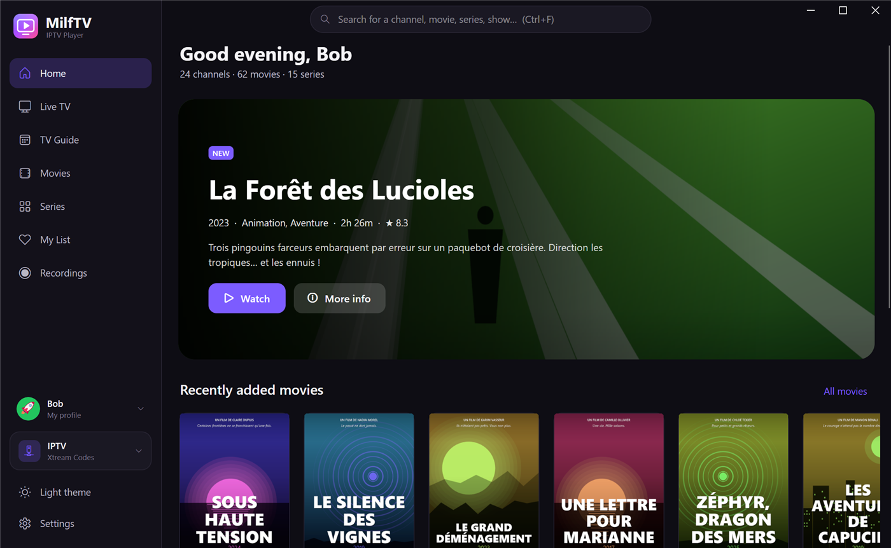
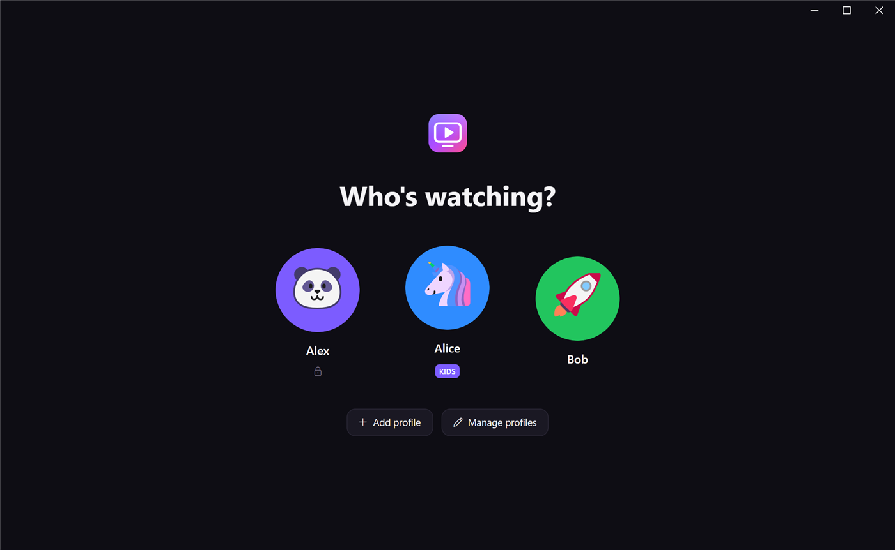
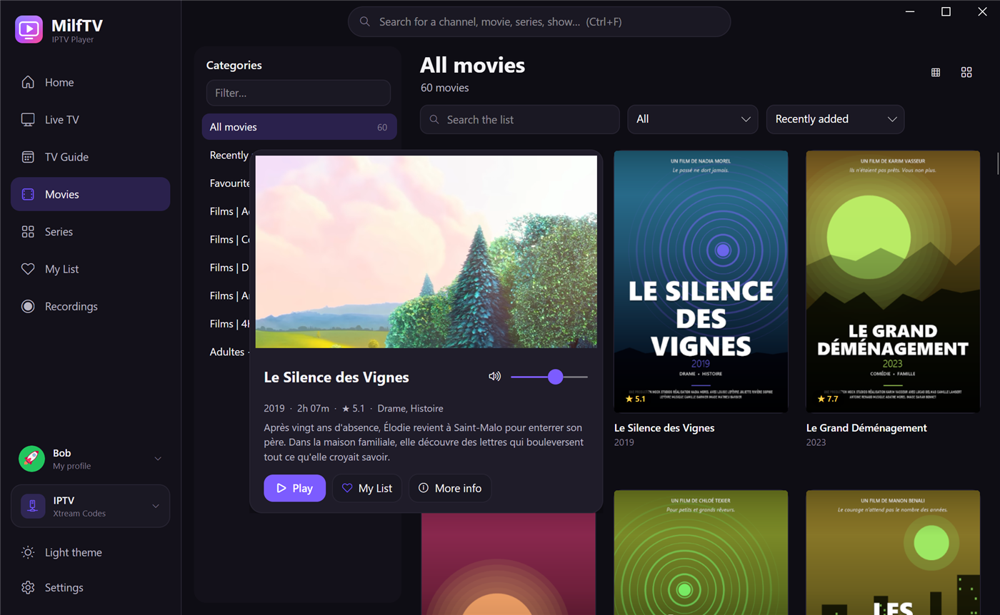
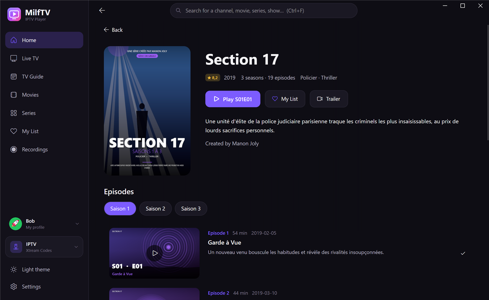
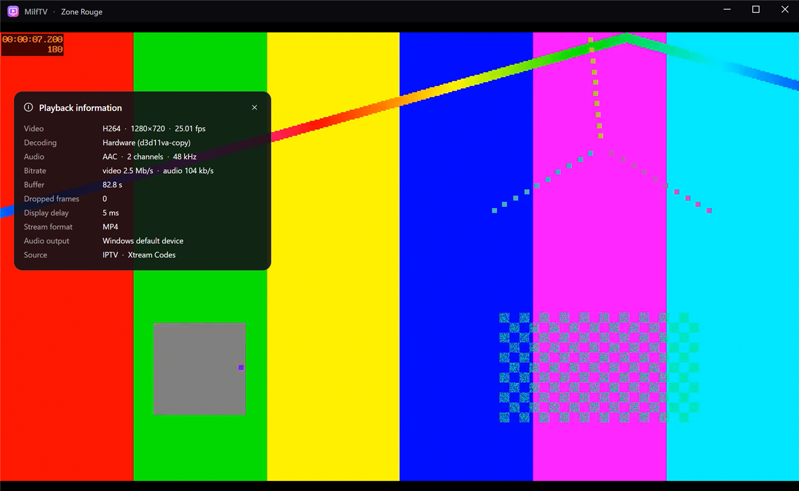
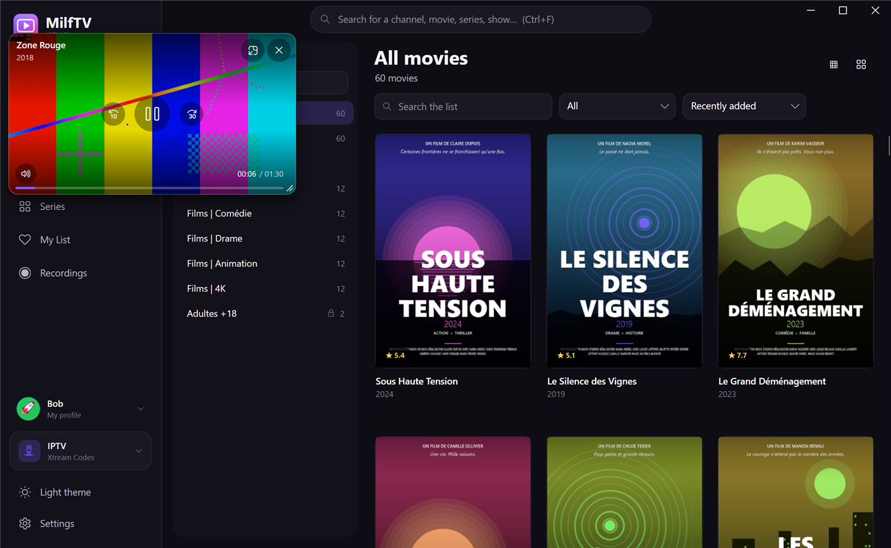
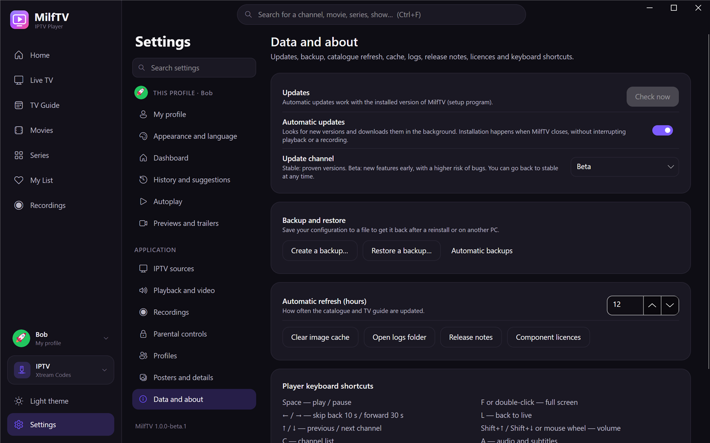

<p align="center"></p>

<h1 align="center">MilfTV</h1>

<p align="center">Un lettore IPTV moderno per Windows: TV in diretta con guida TV, film e serie, registrazioni, profili e controllo parentale.</p>

<p align="center">
  <a href="https://github.com/MilFister/MilfTV/releases"></a>
  
  
  <a href="LICENSE"></a>
</p>

<p align="center"><a href="README.md">English</a> · <a href="README.fr.md">Français</a> · <a href="README.es.md">Español</a> · <a href="README.de.md">Deutsch</a> · <b>Italiano</b> · <a href="README.pt.md">Português</a></p>

> [!IMPORTANT]
> MilfTV è in **beta**: funziona, ma potresti ancora incontrare errori. Segnalali nella scheda [Issues](https://github.com/MilFister/MilfTV/issues).
>
> MilfTV è solo un lettore: non fornisce canali, film né serie. Usalo con il tuo abbonamento IPTV o con playlist che hai il diritto di guardare.



## Sommario

- [Funzionalità](#funzionalità)
- [Schermate](#schermate)
- [Download e installazione](#download-e-installazione)
- [Primi passi](#primi-passi)
- [Aggiornamenti e canale beta](#aggiornamenti-e-canale-beta)
- [I tuoi dati e la tua privacy](#i-tuoi-dati-e-la-tua-privacy)
- [Scorciatoie da tastiera](#scorciatoie-da-tastiera)
- [Risoluzione dei problemi](#risoluzione-dei-problemi)
- [Compilare dal codice sorgente](#compilare-dal-codice-sorgente)
- [Note di rilascio](#note-di-rilascio)
- [Licenza](#licenza)

## Funzionalità

**Sorgenti IPTV**
- Account Xtream Codes, playlist M3U/M3U8 (link o file locale) e portali MAC/Stalker (beta).
- Ogni profilo ha le proprie sorgenti, private o condivise; un profilo senza sorgenti riceve la playlist gratuita «TV gratuite France» (iptv-org).

**TV in diretta**
- Canali per categoria con il programma in corso e il suo avanzamento, canali preferiti e visti di recente.
- Guida TV (XMLTV) a griglia, dalla tua sorgente o da un indirizzo a tua scelta.
- Diretta differita: metti in pausa, torna indietro e raggiungi la diretta.

**Film e serie**
- Griglie di locandine con categorie, ordinamento e filtro «visti / non visti».
- Schede con trama, cast, voto e trailer, arricchite da [TMDB](https://www.themoviedb.org) (chiave gratuita).
- Anteprima al passaggio del puntatore su una locandina, con trailer e regolazione del volume.
- Riprendi da dove avevi lasciato, episodio successivo automatico, cronologia e La mia lista per ogni profilo.

**Lettore**
- Motore [mpv](https://mpv.io): decodifica hardware, sorgenti 4K e HDR, modalità immagine di alta qualità.
- Visualizzazione fluida alla frequenza dello schermo, con alternativa automatica sui PC che non la supportano.
- Tracce audio, sottotitoli, uscita audio, formato dell'immagine, velocità, volume fino al 150 %.
- Menu del clic destro, pannello di informazioni sulla riproduzione, scorciatoie da tastiera.
- Mini lettore: continua a guardare in una finestra mobile e ridimensionabile mentre navighi.

**Registrazioni**
- Registrazione immediata e registrazioni programmate dalla guida TV, in TS, MKV o MP4.
- Protezioni: spazio su disco, limite di registrazioni simultanee, PC tenuto attivo, conferma prima di chiudere.

**Profili e controllo parentale**
- Più profili con avatar, colore, password facoltativa e preferenze proprie.
- Profili bambini, codice parentale, categorie bloccate, blocco automatico delle categorie per adulti.

**E inoltre**
- 6 lingue: italiano, inglese, francese, spagnolo, tedesco, portoghese.
- Temi chiaro e scuro con colore a scelta, schermata iniziale personalizzabile, ricerca globale (Ctrl+F).
- Aggiornamenti automatici (canali Stabile e Beta), backup e ripristino della configurazione, note di rilascio nell'app.

## Schermate

| | |
|---|---|
|  **Profili** |  **Film e anteprima** |
|  **Scheda di una serie** |  **Lettore e informazioni sulla riproduzione** |
|  **Mini lettore** |  **Impostazioni: aggiornamenti e backup** |

<sub>Le schermate mostrano l'interfaccia in inglese e un catalogo da un server di prova con titoli e locandine inventati. Immagine del trailer: *Big Buck Bunny* © Blender Foundation, CC BY 3.0.</sub>

## Download e installazione

Scarica l'ultima versione dalla pagina [Releases](https://github.com/MilFister/MilfTV/releases):

| File | Che cos'è |
|---|---|
| `MilfTV.App-beta-Setup.exe` | **Programma di installazione (consigliato).** Installa MilfTV per il tuo account Windows, senza diritti di amministratore, con un collegamento nel menu Start e aggiornamenti automatici; il collegamento sul desktop viene proposto al primo avvio. |
| `MilfTV.App-beta-Portable.zip` | **Versione portatile.** Estraila dove vuoi ed esegui `MilfTV.exe`; non viene installato nulla. |
| `MilfTV.App-beta-arm64-Setup.exe` | **Programma di installazione per Windows su ARM** (PC ARM64, ad es. Snapdragon). Come sopra, in versione ARM64 nativa. |
| `MilfTV.App-beta-arm64-Portable.zip` | **Versione portatile per Windows su ARM.** |

**Requisiti**
- Windows 10 o 11, su un PC a 64 bit (Intel / AMD) o un PC Windows su ARM (ARM64).
- Una scheda grafica compatibile con Direct3D 11 e con il driver aggiornato.
- Il runtime WebView2 (incluso in Windows 10/11) per i trailer.

**Windows SmartScreen.** Il programma di installazione non è ancora firmato, quindi la prima volta Windows potrebbe mostrare «PC protetto da Windows». Fai clic su **Ulteriori informazioni**, poi su **Esegui comunque**.

**Disinstallazione** da Impostazioni di Windows › App. Profili, impostazioni e cronologia vengono conservati (vedi [I tuoi dati](#i-tuoi-dati-e-la-tua-privacy)).

## Primi passi

1. **Crea il tuo profilo** al primo avvio (nome, avatar, password facoltativa).
2. **Aggiungi una sorgente** dalla barra laterale: un account Xtream Codes (server, nome utente, password), una playlist M3U (link o file) o un portale MAC. Senza sorgenti, viene aggiunta la playlist gratuita «TV gratuite France».
3. **Facoltativo: aggiungi una chiave TMDB** in Impostazioni › Locandine e schede per ottenere locandine di qualità, trame, cast e trailer. La chiave è gratuita su [themoviedb.org](https://www.themoviedb.org/settings/api).
4. Esplora **TV in diretta**, la **Guida TV**, i **Film** e le **Serie**. Fai clic destro sul video per audio, sottotitoli e altro.

## Aggiornamenti e canale beta

La versione installata cerca gli aggiornamenti su GitHub poco dopo l'avvio, poi ogni 12 ore. Una nuova versione viene scaricata in background e installata **alla chiusura di MilfTV**, quindi nulla viene mai interrotto. «Riavvia per installare», in Impostazioni › Dati e informazioni, lo fa subito.

- **Stabile** riceve le versioni collaudate; **Beta** riceve le novità prima, con più rischi di errori. Un'installazione beta resta su Beta per impostazione predefinita.
- Cambia canale in Impostazioni › Dati e informazioni › Canale degli aggiornamenti. Il passaggio a Beta crea prima un backup automatico della configurazione.
- Tornare a Stabile con una beta installata reinstalla l'ultima versione stabile, anche se più vecchia; profili e impostazioni vengono mantenuti.

## I tuoi dati e la tua privacy

MilfTV **non ha account, pubblicità né telemetria**. Si collega solo:
- alle tue sorgenti IPTV e agli indirizzi della guida TV che indichi;
- a TMDB, se hai inserito una chiave (locandine, schede, ricerca dei trailer);
- a YouTube (modalità di privacy avanzata) per riprodurre i trailer;
- a GitHub, per cercare gli aggiornamenti;
- al progetto iptv-org, solo se viene usata la playlist gratuita.

| Dati | Posizione |
|---|---|
| Profili, sorgenti, impostazioni | `%APPDATA%\MilfTV\settings.json` |
| Immagini dei profili | `%APPDATA%\MilfTV\avatars` |
| Cronologia, La mia lista, preferiti, elenco delle registrazioni, guida TV | `%LOCALAPPDATA%\MilfTV\milftv.db` |
| Cache di immagini e cataloghi, memoria della diretta differita | `%LOCALAPPDATA%\MilfTV\cache` |
| Backup automatici | `%LOCALAPPDATA%\MilfTV\backups` |
| Log | `%LOCALAPPDATA%\MilfTV\logs` |
| Applicazione installata | `%LOCALAPPDATA%\MilfTV.App` |
| Registrazioni | `Video\MilfTV` (modificabile) |

Le password delle sorgenti e la chiave TMDB sono cifrate con il tuo account Windows (DPAPI); le password dei profili e il codice parentale sono conservati solo come impronte.

Il controllo parentale tiene i bambini lontani dai contenuti per adulti e dalle impostazioni protette, ma chi usa la tua sessione di Windows può comunque modificare il file delle impostazioni. Per una vera separazione, dai a ogni bambino il proprio account Windows.

**Backup e ripristino** (Impostazioni › Dati e informazioni) salva profili, sorgenti, impostazioni, cronologia, La mia lista, preferiti ed elenco delle registrazioni in un file `.milftv-backup`. Video registrati, guida TV e cache non sono inclusi. Aggiungi una password al backup per ripristinare le password delle sorgenti su un altro PC.

## Scorciatoie da tastiera

| Tasto | Azione |
|---|---|
| Spazio | Riproduci / pausa |
| ← / → | Indietro di 10 s / avanti di 30 s |
| ↑ / ↓ | Canale precedente / successivo |
| Maiusc+↑ / Maiusc+↓, rotellina | Volume |
| F, doppio clic | Schermo intero |
| L | Torna alla diretta |
| C | Elenco dei canali |
| A | Audio e sottotitoli |
| R | Registra |
| M | Disattiva audio |
| I | Mini lettore |
| Esc | Esci dallo schermo intero, poi riduci al mini lettore |
| Ctrl+F | Cerca |

## Risoluzione dei problemi

- **Audio ma niente immagine** (macchina virtuale, desktop remoto, driver molto vecchio): MilfTV ha bisogno dell'accelerazione grafica Direct3D 11. Aggiorna il driver della scheda grafica.
- **La finestra non compare**: al riavvio successivo MilfTV passa da solo alla modalità di visualizzazione compatibile. Puoi anche avviarlo con `MilfTV.exe --safe-mode`.
- **«Il certificato di sicurezza del server non è valido»**: il tuo fornitore usa un certificato HTTPS non valido. Se ti fidi, seleziona «Accetta un certificato non valido» nelle opzioni avanzate della sorgente; su una rete pubblica, la connessione a quel server potrebbe essere intercettata.
- **Un canale non parte**: verificalo in un altro lettore; MilfTV riconnette automaticamente le dirette fino a 5 volte in 2 minuti.
- **Log**: Impostazioni › Dati e informazioni › Apri la cartella dei log. Allega l'ultimo log alla segnalazione dopo averlo controllato: potrebbe contenere l'indirizzo del tuo server.

## Compilare dal codice sorgente

Requisiti: Windows, l'[SDK .NET 10](https://dotnet.microsoft.com/download) e il runtime WebView2.

1. Scarica una build di **libmpv** (`mpv-dev-x86_64-*.7z` da [shinchiro/mpv-winbuild-cmake](https://github.com/shinchiro/mpv-winbuild-cmake/releases)) e copia `libmpv-2.dll` in `native/`. Con circa 120 MB è troppo grande per il repository. `native/vulkan-1.dll` (loader Vulkan di Khronos) è già presente. Per la versione **ARM64** (PC Windows su ARM), metti la `libmpv-2.dll` di `mpv-dev-aarch64-*.7z` in `native/arm64/` (il suo loader Vulkan ARM64 è già presente) e avvia `release.ps1` con `-Arch arm64`: ha i propri canali di aggiornamento.
2. Compila ed esegui:

```powershell
dotnet build src/MilfTV -c Debug
```

3. Build di rilascio con il programma di installazione (Velopack, ripristinato tramite `dotnet tool restore`):

```powershell
.\build\release.ps1 -UpdateRepo https://github.com/MilFister/MilfTV -Version 1.0.0-beta.2 -Channel beta
```

`build\release.ps1` pubblica un eseguibile singolo, crea il programma di installazione, la versione portatile e i pacchetti di aggiornamento in `artifacts\releases`, allega le note di rilascio e può pubblicare su GitHub (`-Upload`, con `$env:GITHUB_TOKEN`) o firmare i file (`-SignParams`, `-AzureSignFile`). `build\changelog.ps1` rigenera i file `CHANGELOG` da `src/MilfTV/Assets/changelog.json`, mostrato anche dall'app.

| Cartella | Contenuto |
|---|---|
| `src/MilfTV/Core` | Modelli, stato centrale, aggiornamenti, backup, note di rilascio |
| `src/MilfTV/Providers` | Sorgenti Xtream, M3U e Stalker |
| `src/MilfTV/Epg` | Guida TV XMLTV |
| `src/MilfTV/Player` | Collegamento a libmpv e superficie video |
| `src/MilfTV/Recording` | Registrazioni |
| `src/MilfTV/ViewModels`, `Views`, `Controls` | Interfaccia (Avalonia, MVVM) |
| `src/MilfTV/Assets/i18n` | Traduzioni (6 lingue) |

Realizzato con [Avalonia](https://avaloniaui.net), [mpv](https://mpv.io), [Velopack](https://velopack.io) e [CommunityToolkit.Mvvm](https://github.com/CommunityToolkit/dotnet).

## Note di rilascio

Vedi [CHANGELOG.it.md](CHANGELOG.it.md), disponibili anche nell'app (Impostazioni › Dati e informazioni › Note di rilascio).

## Licenza

MilfTV è software libero rilasciato sotto la [GNU General Public License v3.0](LICENSE). Include componenti di terze parti (libmpv, il loader Vulkan, Avalonia, SkiaSharp…), elencati con le rispettive licenze in [THIRD-PARTY-NOTICES.md](THIRD-PARTY-NOTICES.md).

Questo prodotto usa l'API di TMDB ma non è approvato né certificato da TMDB.
