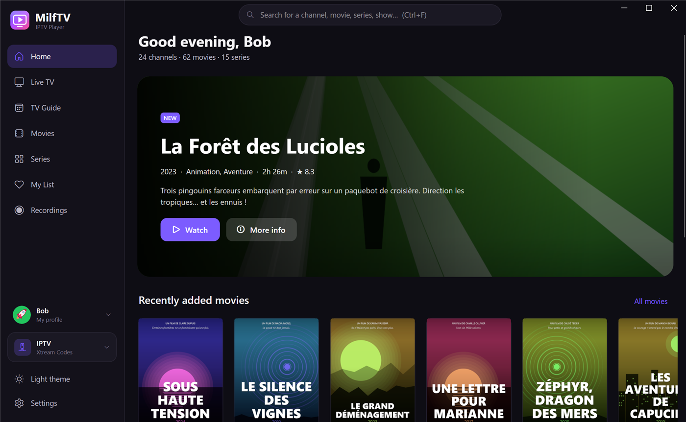
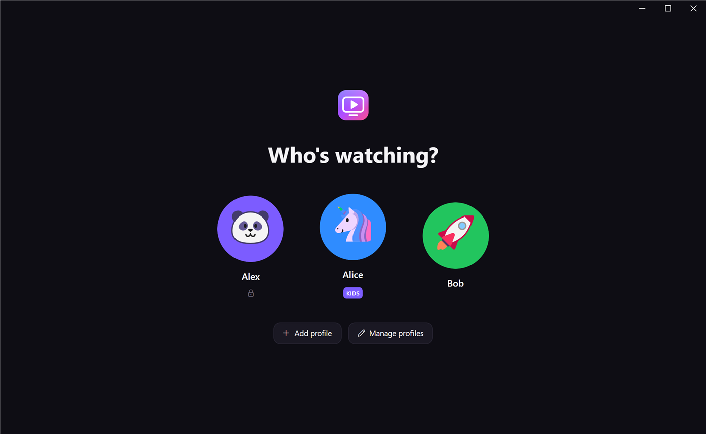
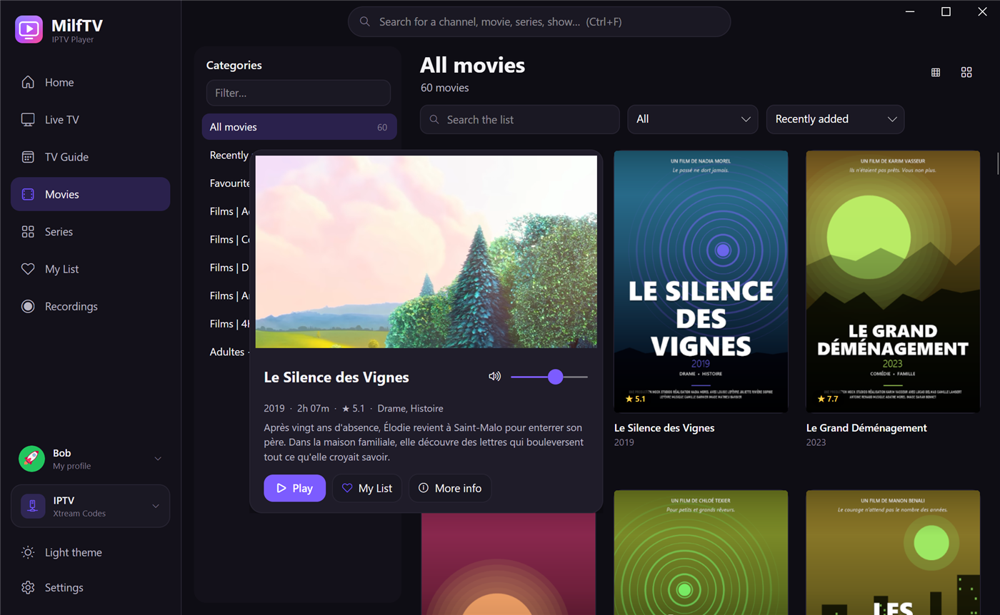
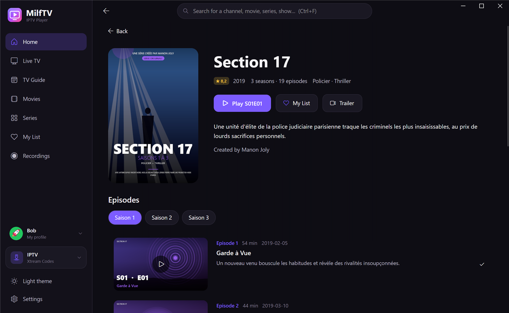
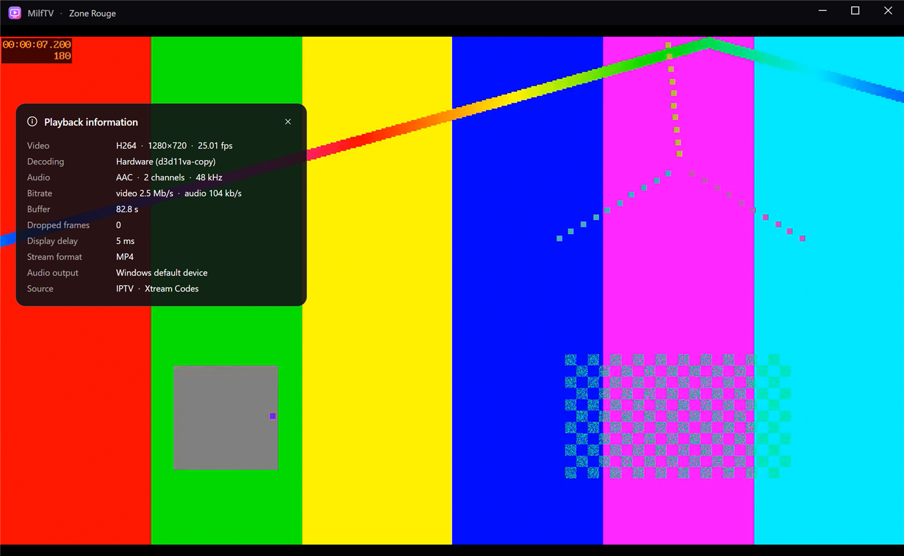
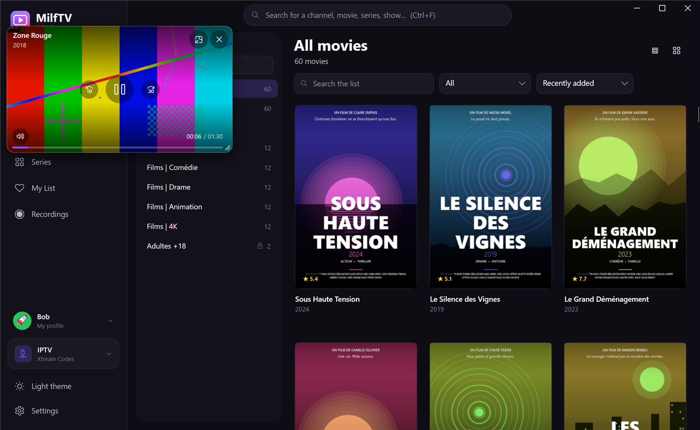
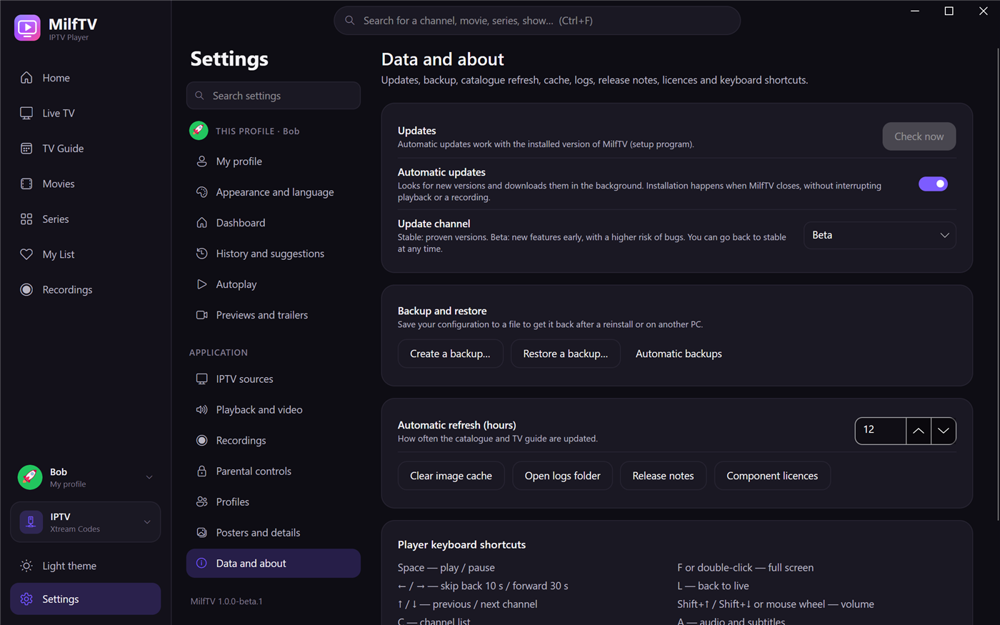

<p align="center"></p>

<h1 align="center">MilfTV</h1>

<p align="center">A modern IPTV player for Windows: live TV with a TV guide, films and series, recordings, profiles and parental control.</p>

<p align="center">
  <a href="https://github.com/MilFister/MilfTV/releases"></a>
  
  
  <a href="LICENSE"></a>
</p>

<p align="center"><b>English</b> · <a href="README.fr.md">Français</a> · <a href="README.es.md">Español</a> · <a href="README.de.md">Deutsch</a> · <a href="README.it.md">Italiano</a> · <a href="README.pt.md">Português</a></p>

> [!IMPORTANT]
> MilfTV is in **beta**: it works, but you may still run into bugs. Please report them in the [Issues](https://github.com/MilFister/MilfTV/issues) tab.
>
> MilfTV is a player only: it does not provide any channel, film or series. Use it with your own IPTV subscription or playlists you are allowed to watch.



## Contents

- [Features](#features)
- [Screenshots](#screenshots)
- [Download and installation](#download-and-installation)
- [Getting started](#getting-started)
- [Updates and beta channel](#updates-and-beta-channel)
- [Your data and privacy](#your-data-and-privacy)
- [Keyboard shortcuts](#keyboard-shortcuts)
- [Troubleshooting](#troubleshooting)
- [Building from source](#building-from-source)
- [Release notes](#release-notes)
- [Licence](#licence)

## Features

**IPTV sources**
- Xtream Codes accounts, M3U/M3U8 playlists (link or local file) and MAC/Stalker portals (beta).
- Each profile has its own sources, private or shared; a profile without a source gets the free "TV gratuite France" playlist (iptv-org).

**Live TV**
- Channels by category with the current programme and its progress, favourites and recently watched channels.
- TV guide (XMLTV) as a grid, from your source or from an address of your choice.
- Timeshift: pause, rewind and catch up with live.

**Films and series**
- Poster grids with categories, sorting and a "watched / not watched" filter.
- Detail pages with synopsis, cast, rating and trailer, enriched by [TMDB](https://www.themoviedb.org) (free key).
- Hover a poster for a preview with its trailer and a volume control.
- Resume where you left off, autoplay of the next episode, history and My List for each profile.

**Player**
- [mpv](https://mpv.io) engine: hardware decoding, 4K and HDR sources, high-quality picture mode.
- Smooth display at the screen refresh rate, with an automatic fallback on PCs that do not support it.
- Audio tracks, subtitles, audio output device, aspect ratio, speed, volume up to 150 %.
- Right-click menu, playback information panel, keyboard shortcuts.
- Mini player: keep watching in a floating, resizable window while you browse.

**Recordings**
- Instant recording and scheduled recordings from the TV guide, in TS, MKV or MP4.
- Safeguards: free disk space, simultaneous recording limit, PC kept awake, confirmation before closing.

**Profiles and parental control**
- Several profiles with avatar, colour, optional password and their own preferences.
- Kids profiles, parental PIN, locked categories, automatic locking of adult categories.

**Everything else**
- 6 languages: English, French, Spanish, German, Italian, Portuguese.
- Light and dark themes with a choice of colour, customisable home screen, global search (Ctrl+F).
- Automatic updates (Stable and Beta channels), backup and restore of the configuration, release notes in the app.

## Screenshots

| | |
|---|---|
|  **Profiles** |  **Movies and hover preview** |
|  **Series page** |  **Player and playback information** |
|  **Mini player** |  **Settings: updates and backup** |

<sub>The catalogue in the screenshots comes from a test server with made-up titles and posters. Trailer image: *Big Buck Bunny* © Blender Foundation, CC BY 3.0.</sub>

## Download and installation

Download the latest version from the [Releases](https://github.com/MilFister/MilfTV/releases) page:

| File | What it is |
|---|---|
| `MilfTV.App-beta-Setup.exe` | **Installer (recommended).** Installs MilfTV for your Windows account, without administrator rights, with a Start menu shortcut and automatic updates; a desktop shortcut is offered at first launch. |
| `MilfTV.App-beta-Portable.zip` | **Portable version.** Unzip it anywhere and run `MilfTV.exe`; nothing is installed. |
| `MilfTV.App-beta-arm64-Setup.exe` | **Installer for Windows on ARM** (ARM64 PCs, e.g. Snapdragon). Same as above, native ARM64 version. |
| `MilfTV.App-beta-arm64-Portable.zip` | **Portable version for Windows on ARM.** |

**Requirements**
- Windows 10 or 11, on a 64-bit PC (Intel / AMD) or a Windows on ARM PC (ARM64).
- A graphics card with Direct3D 11 and an up-to-date driver.
- The WebView2 runtime (included in Windows 10/11) for trailers.

**Windows SmartScreen.** The installer is not signed yet, so Windows may show "Windows protected your PC" the first time. Click **More info**, then **Run anyway**.

**Uninstall** from Windows Settings › Apps. Your profiles, settings and history are kept (see [Your data](#your-data-and-privacy)).

## Getting started

1. **Create your profile** at first launch (name, avatar, optional password).
2. **Add a source** from the sidebar: an Xtream Codes account (server, username, password), an M3U playlist (link or file) or a MAC portal. Without a source, the free "TV gratuite France" playlist is added for you.
3. **Optional: add a TMDB key** in Settings › Posters and details to get high-quality posters, synopses, cast and trailers. The key is free on [themoviedb.org](https://www.themoviedb.org/settings/api).
4. Explore **Live TV**, the **TV guide**, **Movies** and **Series**. Right-click the video for audio, subtitles and more.

## Updates and beta channel

The installed version checks for updates on GitHub shortly after it starts, then every 12 hours. A new version is downloaded in the background and installed **when you close MilfTV**, so nothing is ever interrupted. "Restart to install" in Settings › Data and about does it right away.

- **Stable** receives tested versions; **Beta** gets new features earlier, with a higher risk of bugs. A beta installation stays on Beta by default.
- Change the channel in Settings › Data and about › Update channel. Switching to Beta first makes an automatic backup of your configuration.
- Going back to Stable while a beta is installed reinstalls the latest stable version, even if it is older; your profiles and settings are kept.

## Your data and privacy

MilfTV has **no account, no advertising and no telemetry**. It only connects to:
- your IPTV sources and the TV guide addresses you set;
- TMDB, if you entered a key (posters, details, trailer search);
- YouTube (privacy-enhanced mode) to play trailers;
- GitHub, to check for updates;
- the iptv-org project, only if the free playlist is used.

| Data | Location |
|---|---|
| Profiles, sources, settings | `%APPDATA%\MilfTV\settings.json` |
| Profile pictures | `%APPDATA%\MilfTV\avatars` |
| History, My List, favourites, recordings list, TV guide | `%LOCALAPPDATA%\MilfTV\milftv.db` |
| Image and catalogue cache, timeshift buffer | `%LOCALAPPDATA%\MilfTV\cache` |
| Automatic backups | `%LOCALAPPDATA%\MilfTV\backups` |
| Logs | `%LOCALAPPDATA%\MilfTV\logs` |
| Installed application | `%LOCALAPPDATA%\MilfTV.App` |
| Recordings | `Videos\MilfTV` (configurable) |

Source passwords and the TMDB key are encrypted with your Windows account (DPAPI); profile passwords and the parental PIN are stored as hashes only.

Parental control keeps children away from adult content and protected settings, but someone who can use your Windows session can still edit the settings file. For real separation, give each child their own Windows account.

**Backup and restore** (Settings › Data and about) saves your profiles, sources, settings, history, My List, favourites and recordings list to a `.milftv-backup` file. Recorded videos, the TV guide and caches are not included. Add a backup password to restore source passwords on another PC.

## Keyboard shortcuts

| Key | Action |
|---|---|
| Space | Play / pause |
| ← / → | Back 10 s / forward 30 s |
| ↑ / ↓ | Previous / next channel |
| Shift+↑ / Shift+↓, mouse wheel | Volume |
| F, double-click | Full screen |
| L | Back to live |
| C | Channel list |
| A | Audio and subtitles |
| R | Record |
| M | Mute |
| I | Mini player |
| Esc | Leave full screen, then shrink to the mini player |
| Ctrl+F | Search |

## Troubleshooting

- **Sound but no picture** (virtual machine, remote desktop, very old driver): MilfTV needs Direct3D 11 graphics acceleration. Update your graphics driver.
- **The window does not appear**: MilfTV switches to compatible display mode by itself at the next start. You can also start it with `MilfTV.exe --safe-mode`.
- **"The server's security certificate is not valid"**: your provider uses an invalid HTTPS certificate. If you trust it, tick "Accept an invalid certificate" in the source's advanced options; on a public network, the connection to that server could then be intercepted.
- **A channel does not play**: check it in another player; MilfTV reconnects live streams automatically up to 5 times in 2 minutes.
- **Logs**: Settings › Data and about › Open logs folder. Attach the latest log to your bug report after a quick look: it may mention your server address.

## Building from source

Requirements: Windows, the [.NET 10 SDK](https://dotnet.microsoft.com/download) and the WebView2 runtime.

1. Download a **libmpv** build (`mpv-dev-x86_64-*.7z` from [shinchiro/mpv-winbuild-cmake](https://github.com/shinchiro/mpv-winbuild-cmake/releases)) and copy `libmpv-2.dll` into `native/`. At about 120 MB it is too large for the repository. `native/vulkan-1.dll` (Khronos Vulkan loader) is already there. For the **ARM64** version (Windows on ARM PCs), put the `libmpv-2.dll` from `mpv-dev-aarch64-*.7z` into `native/arm64/` (its ARM64 Vulkan loader is already there) and run `release.ps1` with `-Arch arm64`: it uses its own update channels.
2. Build and run:

```powershell
dotnet build src/MilfTV -c Debug
```

3. Release build with the installer (Velopack, restored through `dotnet tool restore`):

```powershell
.\build\release.ps1 -UpdateRepo https://github.com/MilFister/MilfTV -Version 1.0.0-beta.2 -Channel beta
```

`build\release.ps1` publishes a single-file executable, builds the installer, the portable zip and the update packages in `artifacts\releases`, attaches the release notes, and can publish to GitHub (`-Upload`, with `$env:GITHUB_TOKEN`) or sign the files (`-SignParams`, `-AzureSignFile`). `build\changelog.ps1` regenerates the `CHANGELOG` files from `src/MilfTV/Assets/changelog.json`, which the app displays too.

| Folder | Contents |
|---|---|
| `src/MilfTV/Core` | Models, central state, updates, backup, release notes |
| `src/MilfTV/Providers` | Xtream, M3U and Stalker sources |
| `src/MilfTV/Epg` | XMLTV TV guide |
| `src/MilfTV/Player` | libmpv binding and video surface |
| `src/MilfTV/Recording` | Recordings |
| `src/MilfTV/ViewModels`, `Views`, `Controls` | Interface (Avalonia, MVVM) |
| `src/MilfTV/Assets/i18n` | Translations (6 languages) |

Built with [Avalonia](https://avaloniaui.net), [mpv](https://mpv.io), [Velopack](https://velopack.io) and [CommunityToolkit.Mvvm](https://github.com/CommunityToolkit/dotnet).

## Release notes

See [CHANGELOG.md](CHANGELOG.md), also available in the app (Settings › Data and about › Release notes).

## Licence

MilfTV is free software under the [GNU General Public License v3.0](LICENSE). It includes third-party components (libmpv, the Vulkan loader, Avalonia, SkiaSharp…), listed with their licences in [THIRD-PARTY-NOTICES.md](THIRD-PARTY-NOTICES.md).

This product uses the TMDB API but is not endorsed or certified by TMDB.
