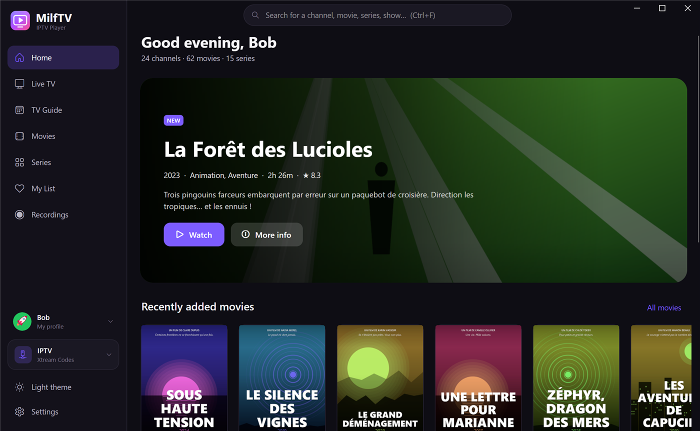
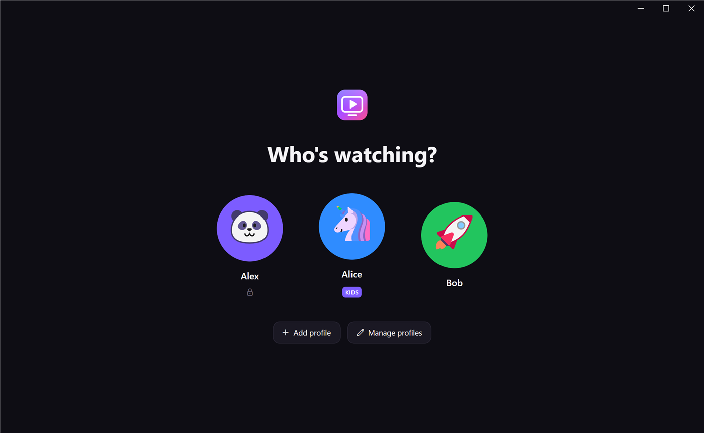
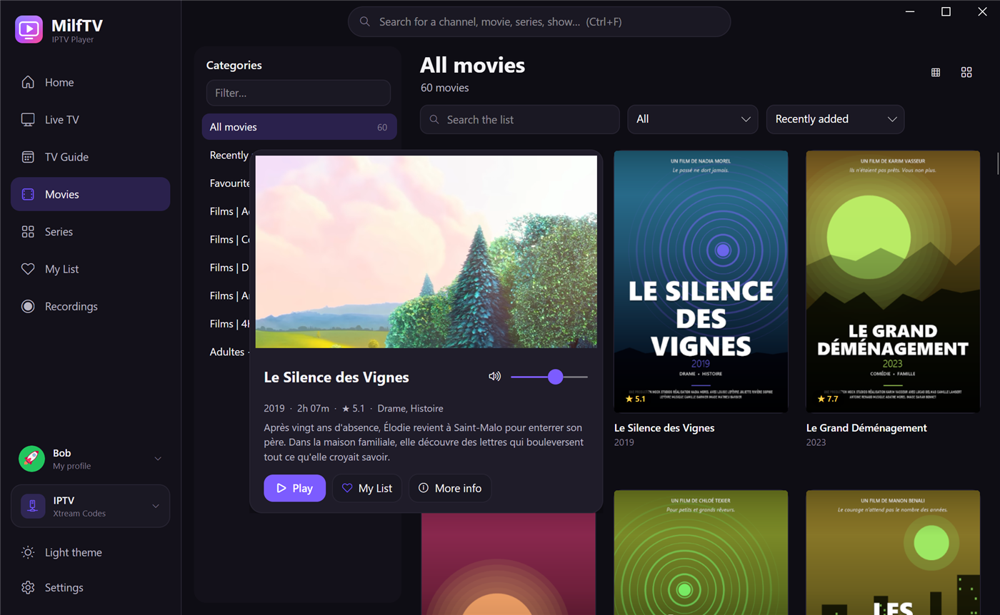
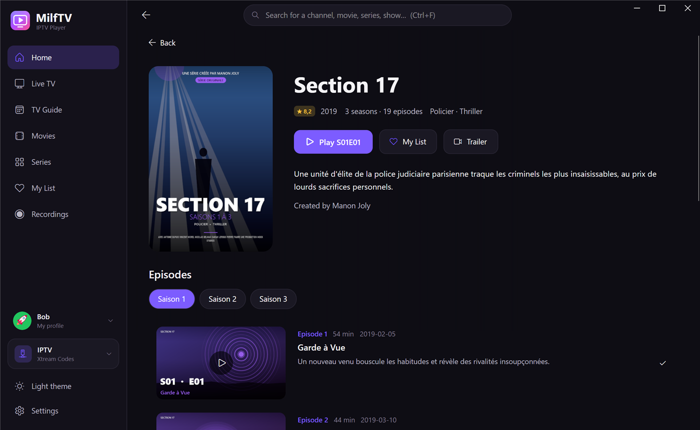
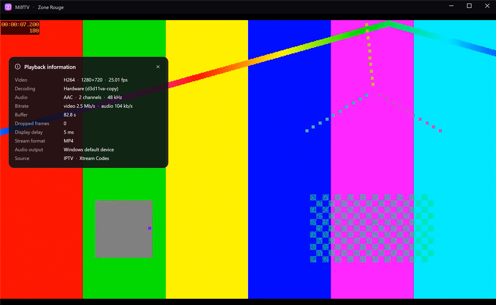
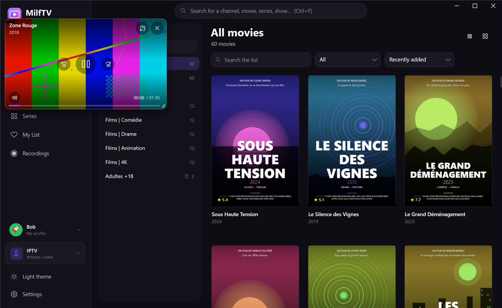
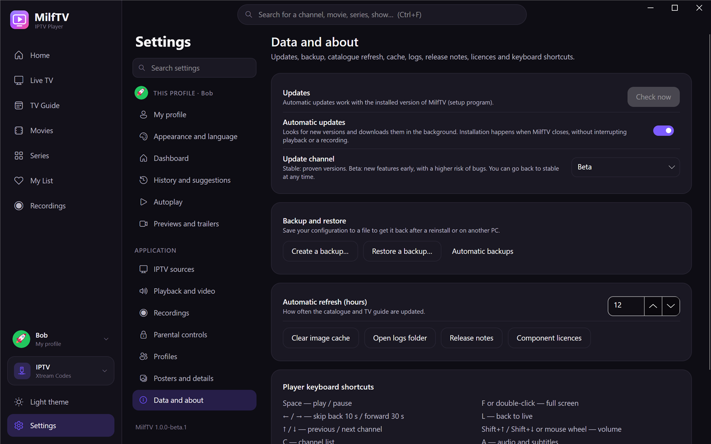

<p align="center"></p>

<h1 align="center">MilfTV</h1>

<p align="center">Um leitor IPTV moderno para Windows: TV em direto com guia de programação, filmes e séries, gravações, perfis e controlo parental.</p>

<p align="center">
  <a href="https://github.com/MilFister/MilfTV/releases"></a>
  
  
  <a href="LICENSE"></a>
</p>

<p align="center"><a href="README.md">English</a> · <a href="README.fr.md">Français</a> · <a href="README.es.md">Español</a> · <a href="README.de.md">Deutsch</a> · <a href="README.it.md">Italiano</a> · <b>Português</b></p>

> [!IMPORTANT]
> O MilfTV está em **beta**: funciona, mas ainda pode encontrar erros. Comunique-os no separador [Issues](https://github.com/MilFister/MilfTV/issues).
>
> O MilfTV é apenas um leitor: não fornece nenhum canal, filme ou série. Utilize-o com a sua própria subscrição IPTV ou com listas que tenha o direito de ver.



## Índice

- [Funcionalidades](#funcionalidades)
- [Capturas de ecrã](#capturas-de-ecrã)
- [Transferência e instalação](#transferência-e-instalação)
- [Primeiros passos](#primeiros-passos)
- [Atualizações e canal beta](#atualizações-e-canal-beta)
- [Os seus dados e a sua privacidade](#os-seus-dados-e-a-sua-privacidade)
- [Atalhos de teclado](#atalhos-de-teclado)
- [Resolução de problemas](#resolução-de-problemas)
- [Compilar a partir do código-fonte](#compilar-a-partir-do-código-fonte)
- [Notas da versão](#notas-da-versão)
- [Licença](#licença)

## Funcionalidades

**Fontes IPTV**
- Contas Xtream Codes, listas M3U/M3U8 (ligação ou ficheiro local) e portais MAC/Stalker (beta).
- Cada perfil tem as suas próprias fontes, privadas ou partilhadas; um perfil sem fonte recebe a lista gratuita «TV gratuite France» (iptv-org).

**TV em direto**
- Canais por categoria com o programa em curso e o seu progresso, canais favoritos e vistos recentemente.
- Guia de TV (XMLTV) em grelha, da sua fonte ou de um endereço à sua escolha.
- Diferido: pause, recue e volte ao direto.

**Filmes e séries**
- Grelhas de cartazes com categorias, ordenação e filtro «vistos / não vistos».
- Fichas com sinopse, elenco, classificação e trailer, enriquecidas pelo [TMDB](https://www.themoviedb.org) (chave gratuita).
- Pré-visualização ao passar o ponteiro sobre um cartaz, com trailer e controlo de volume.
- Retome onde parou, episódio seguinte automático, histórico e A minha lista para cada perfil.

**Leitor**
- Motor [mpv](https://mpv.io): descodificação por hardware, fontes 4K e HDR, modo de imagem de alta qualidade.
- Visualização fluida à frequência do ecrã, com alternativa automática nos PC que não a suportam.
- Faixas de áudio, legendas, saída de áudio, formato de imagem, velocidade, volume até 150 %.
- Menu do clique direito, painel de informações de reprodução, atalhos de teclado.
- Minileitor: continue a ver numa janela flutuante e redimensionável enquanto navega.

**Gravações**
- Gravação imediata e gravações agendadas a partir do guia de TV, em TS, MKV ou MP4.
- Salvaguardas: espaço em disco, limite de gravações simultâneas, PC mantido ativo, confirmação antes de fechar.

**Perfis e controlo parental**
- Vários perfis com avatar, cor, palavra-passe opcional e preferências próprias.
- Perfis infantis, código parental, categorias bloqueadas, bloqueio automático das categorias para adultos.

**E ainda**
- 6 idiomas: português, inglês, francês, espanhol, alemão, italiano.
- Temas claro e escuro com cor à escolha, ecrã inicial personalizável, pesquisa global (Ctrl+F).
- Atualizações automáticas (canais Estável e Beta), cópia de segurança e restauro da configuração, notas da versão na aplicação.

## Capturas de ecrã

| | |
|---|---|
|  **Perfis** |  **Filmes e pré-visualização** |
|  **Ficha de uma série** |  **Leitor e informações de reprodução** |
|  **Minileitor** |  **Definições: atualizações e cópia de segurança** |

<sub>As capturas mostram a interface em inglês e um catálogo de um servidor de teste com títulos e cartazes inventados. Imagem do trailer: *Big Buck Bunny* © Blender Foundation, CC BY 3.0.</sub>

## Transferência e instalação

Transfira a versão mais recente na página [Releases](https://github.com/MilFister/MilfTV/releases):

| Ficheiro | O que é |
|---|---|
| `MilfTV.App-beta-Setup.exe` | **Instalador (recomendado).** Instala o MilfTV para a sua conta Windows, sem direitos de administrador, com atalhos no ambiente de trabalho e no menu Iniciar, e atualizações automáticas. |
| `MilfTV.App-beta-Portable.zip` | **Versão portátil.** Descompacte-a onde quiser e execute `MilfTV.exe`; nada é instalado. |

**Requisitos**
- Windows 10 ou 11 de 64 bits.
- Uma placa gráfica compatível com Direct3D 11 e com o controlador atualizado.
- O runtime WebView2 (incluído no Windows 10/11) para os trailers.

**Windows SmartScreen.** O instalador ainda não está assinado, por isso o Windows pode mostrar «O Windows protegeu o computador» da primeira vez. Clique em **Mais informações** e depois em **Executar mesmo assim**.

**Desinstalar** a partir de Definições do Windows › Aplicações. Os seus perfis, definições e histórico são mantidos (ver [Os seus dados](#os-seus-dados-e-a-sua-privacidade)).

## Primeiros passos

1. **Crie o seu perfil** no primeiro arranque (nome, avatar, palavra-passe opcional).
2. **Adicione uma fonte** a partir da barra lateral: uma conta Xtream Codes (servidor, utilizador, palavra-passe), uma lista M3U (ligação ou ficheiro) ou um portal MAC. Sem fonte, é adicionada a lista gratuita «TV gratuite France».
3. **Opcional: adicione uma chave TMDB** em Definições › Cartazes e fichas para obter cartazes de qualidade, sinopses, elenco e trailers. A chave é gratuita em [themoviedb.org](https://www.themoviedb.org/settings/api).
4. Explore a **TV em direto**, o **Guia de TV**, os **Filmes** e as **Séries**. Clique com o botão direito no vídeo para o áudio, as legendas e muito mais.

## Atualizações e canal beta

A versão instalada procura atualizações no GitHub pouco depois de arrancar e depois a cada 12 horas. Uma nova versão é transferida em segundo plano e instalada **ao fechar o MilfTV**, por isso nada é interrompido. «Reiniciar para instalar», em Definições › Dados e acerca de, fá-lo de imediato.

- **Estável** recebe as versões testadas; **Beta** recebe as novidades mais cedo, com mais risco de erros. Uma instalação beta mantém-se em Beta por predefinição.
- Mude de canal em Definições › Dados e acerca de › Canal de atualizações. A passagem para Beta cria primeiro uma cópia automática da sua configuração.
- Voltar ao Estável com uma beta instalada reinstala a versão estável mais recente, mesmo que seja mais antiga; os seus perfis e definições são mantidos.

## Os seus dados e a sua privacidade

O MilfTV **não tem conta, publicidade nem telemetria**. Liga-se apenas:
- às suas fontes IPTV e aos endereços de guia de TV que indicar;
- ao TMDB, se tiver introduzido uma chave (cartazes, fichas, pesquisa de trailers);
- ao YouTube (modo de privacidade melhorada) para reproduzir os trailers;
- ao GitHub, para procurar atualizações;
- ao projeto iptv-org, apenas se a lista gratuita for utilizada.

| Dados | Localização |
|---|---|
| Perfis, fontes, definições | `%APPDATA%\MilfTV\settings.json` |
| Imagens dos perfis | `%APPDATA%\MilfTV\avatars` |
| Histórico, A minha lista, favoritos, lista de gravações, guia de TV | `%LOCALAPPDATA%\MilfTV\milftv.db` |
| Cache de imagens e catálogos, memória do diferido | `%LOCALAPPDATA%\MilfTV\cache` |
| Cópias automáticas | `%LOCALAPPDATA%\MilfTV\backups` |
| Registos | `%LOCALAPPDATA%\MilfTV\logs` |
| Aplicação instalada | `%LOCALAPPDATA%\MilfTV.App` |
| Gravações | `Vídeos\MilfTV` (configurável) |

As palavras-passe das fontes e a chave TMDB são cifradas com a sua conta Windows (DPAPI); as palavras-passe dos perfis e o código parental são guardados apenas como impressões digitais (hashes).

**Cópia de segurança e restauro** (Definições › Dados e acerca de) guarda os seus perfis, fontes, definições, histórico, A minha lista, favoritos e lista de gravações num ficheiro `.milftv-backup`. Os vídeos gravados, o guia de TV e as caches não são incluídos. Adicione uma palavra-passe à cópia para restaurar as palavras-passe das fontes noutro PC.

## Atalhos de teclado

| Tecla | Ação |
|---|---|
| Espaço | Reproduzir / pausa |
| ← / → | Recuar 10 s / avançar 30 s |
| ↑ / ↓ | Canal anterior / seguinte |
| Shift+↑ / Shift+↓, roda do rato | Volume |
| F, duplo clique | Ecrã inteiro |
| L | Voltar ao direto |
| C | Lista de canais |
| A | Áudio e legendas |
| R | Gravar |
| M | Sem som |
| I | Minileitor |
| Esc | Sair do ecrã inteiro e depois reduzir ao minileitor |
| Ctrl+F | Pesquisar |

## Resolução de problemas

- **Há som mas não há imagem** (máquina virtual, ambiente de trabalho remoto, controlador muito antigo): o MilfTV precisa da aceleração gráfica Direct3D 11. Atualize o controlador da sua placa gráfica.
- **A janela não aparece**: o MilfTV passa sozinho para o modo de visualização compatível no arranque seguinte. Também o pode iniciar com `MilfTV.exe --safe-mode`.
- **Um canal não reproduz**: verifique-o noutro leitor; o MilfTV volta a ligar os diretos automaticamente até 5 vezes em 2 minutos.
- **Registos**: Definições › Dados e acerca de › Abrir a pasta de registos. Junte o registo mais recente ao seu relatório depois de o ver: pode mencionar o endereço do seu servidor.

## Compilar a partir do código-fonte

Requisitos: Windows, o [SDK .NET 10](https://dotnet.microsoft.com/download) e o runtime WebView2.

1. Transfira uma compilação da **libmpv** (`mpv-dev-x86_64-*.7z` em [shinchiro/mpv-winbuild-cmake](https://github.com/shinchiro/mpv-winbuild-cmake/releases)) e copie `libmpv-2.dll` para `native/`. Com cerca de 120 MB, é demasiado grande para o repositório. `native/vulkan-1.dll` (carregador Vulkan da Khronos) já está incluído.
2. Compile e execute:

```powershell
dotnet build src/MilfTV -c Debug
```

3. Versão de publicação com o instalador (Velopack, restaurado através de `dotnet tool restore`):

```powershell
.\build\release.ps1 -UpdateRepo https://github.com/MilFister/MilfTV -Version 1.0.0-beta.1 -Channel beta
```

`build\release.ps1` publica um executável único, cria o instalador, a versão portátil e os pacotes de atualização em `artifacts\releases`, junta as notas da versão e pode publicar no GitHub (`-Upload`, com `$env:GITHUB_TOKEN`) ou assinar os ficheiros (`-SignParams`, `-AzureSignFile`). `build\changelog.ps1` gera novamente os ficheiros `CHANGELOG` a partir de `src/MilfTV/Assets/changelog.json`, que a aplicação também mostra.

| Pasta | Conteúdo |
|---|---|
| `src/MilfTV/Core` | Modelos, estado central, atualizações, cópias de segurança, notas da versão |
| `src/MilfTV/Providers` | Fontes Xtream, M3U e Stalker |
| `src/MilfTV/Epg` | Guia de TV XMLTV |
| `src/MilfTV/Player` | Ligação à libmpv e superfície de vídeo |
| `src/MilfTV/Recording` | Gravações |
| `src/MilfTV/ViewModels`, `Views`, `Controls` | Interface (Avalonia, MVVM) |
| `src/MilfTV/Assets/i18n` | Traduções (6 idiomas) |

Criado com [Avalonia](https://avaloniaui.net), [mpv](https://mpv.io), [Velopack](https://velopack.io) e [CommunityToolkit.Mvvm](https://github.com/CommunityToolkit/dotnet).

## Notas da versão

Consulte [CHANGELOG.pt.md](CHANGELOG.pt.md), também disponíveis na aplicação (Definições › Dados e acerca de › Notas da versão).

## Licença

O MilfTV é software livre sob a [GNU General Public License v3.0](LICENSE). Inclui componentes de terceiros (libmpv, o carregador Vulkan, Avalonia, SkiaSharp…), indicados com as respetivas licenças em [THIRD-PARTY-NOTICES.md](THIRD-PARTY-NOTICES.md).

Este produto usa a API do TMDB, mas não é aprovado nem certificado pelo TMDB.
